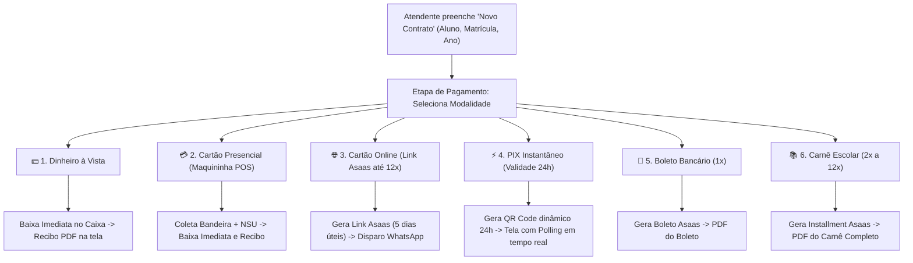
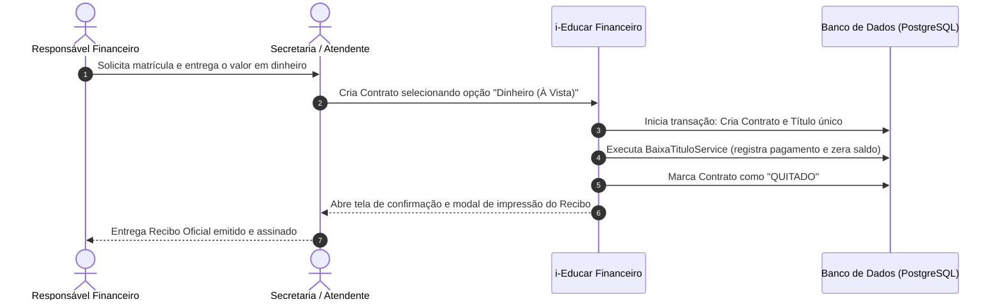
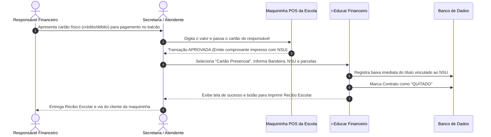
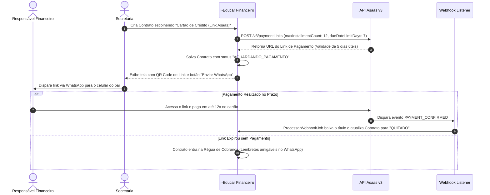
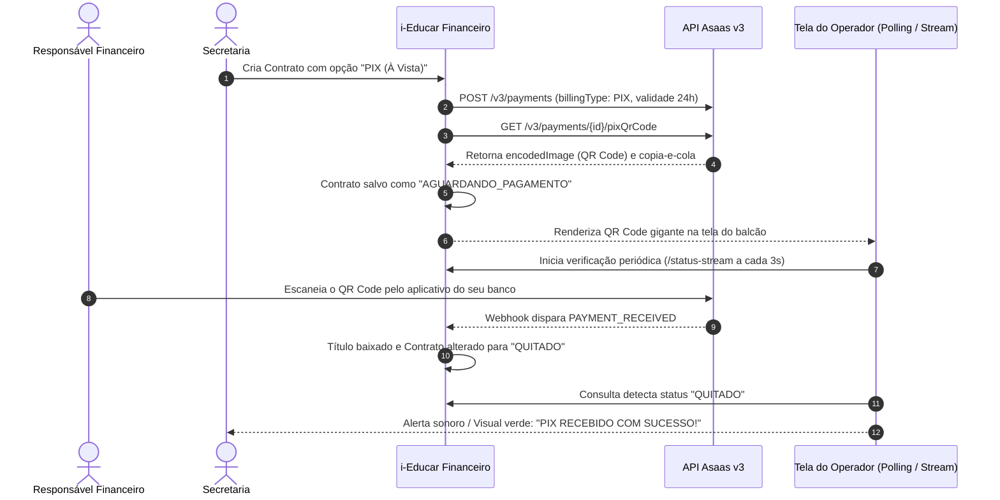
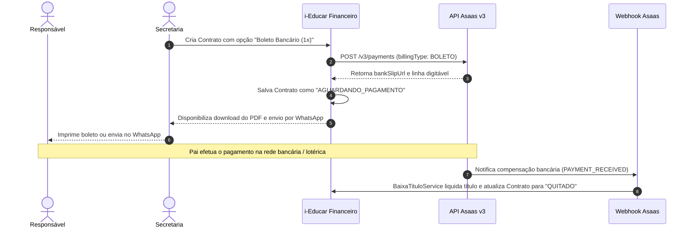
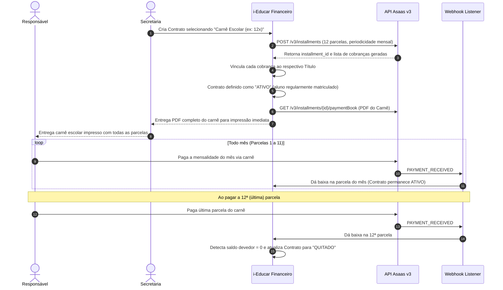
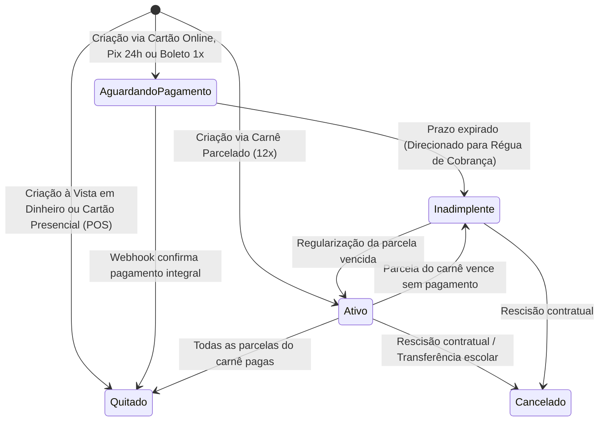

# FLUXO — Diagramas e Fluxos Operacionais de Pagamentos e Contratos

**Módulo Financeiro i-Educar**  
**Versão:** 3.1.0  
**Data:** 15/10/2026  

---

## 1. Visão Geral: O Checkout Escolar na Criação de Contrato

---

## 2. Fluxo 1: Pagamento à Vista em Dinheiro (Balcão)

---

## 3. Fluxo 2: Cartão Presencial na Maquininha (Balcão / POS)

---

## 4. Fluxo 3: Cartão de Crédito Parcelado via Link Asaas (até 12x)

---

## 5. Fluxo 4: PIX Instantâneo com QR Code em Tempo Real (24h)

---

## 6. Fluxo 5: Boleto Bancário (1x À Vista)

---

## 7. Fluxo 6: Carnê Escolar Parcelado (2x a 12x via Asaas)

---

## 8. Diagrama de Transições da Máquina de Estados

