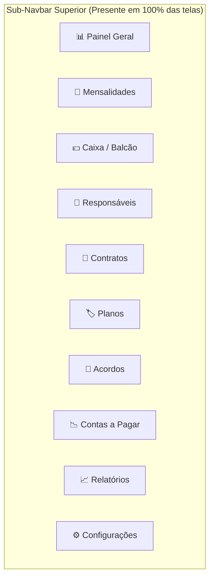
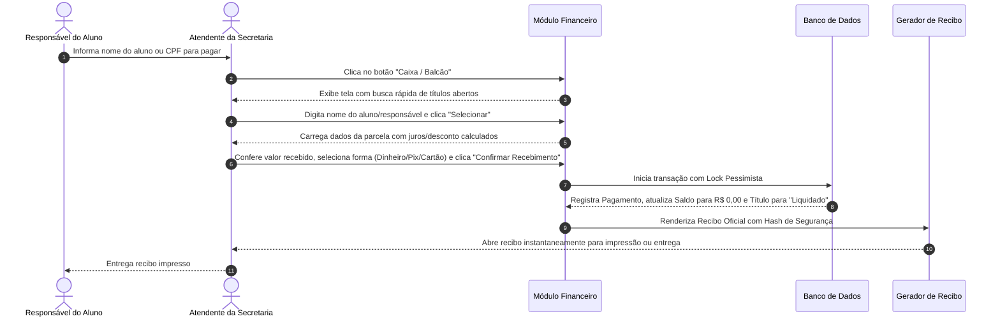
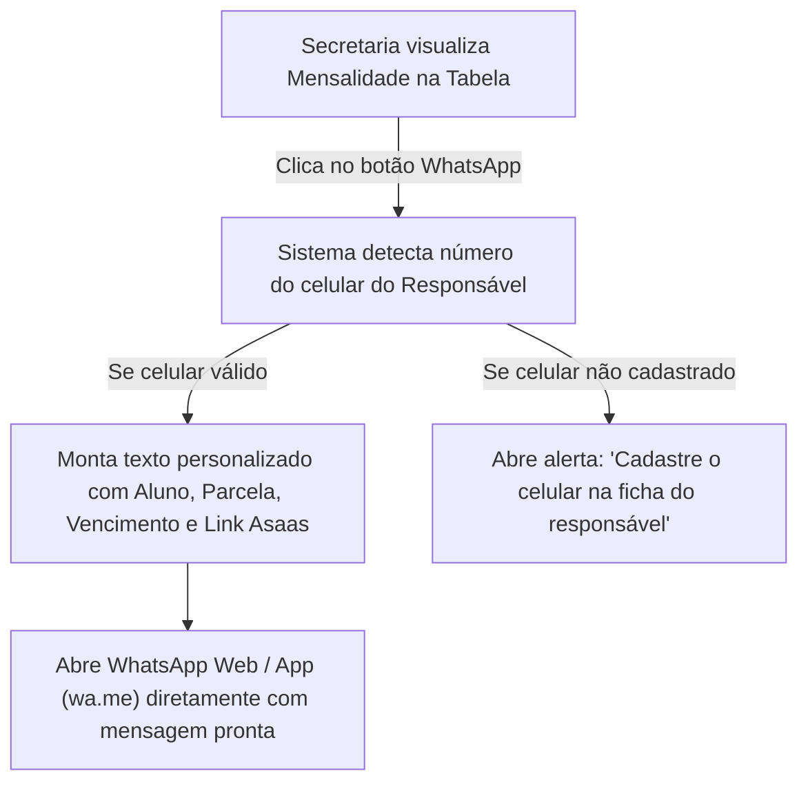
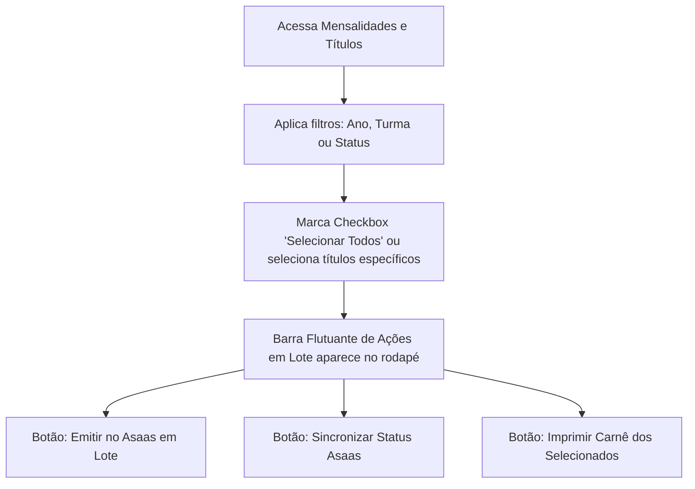
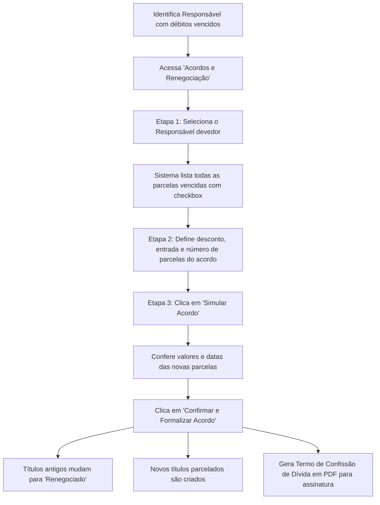

# FLUXO — Arquitetura de Navegação e Fluxos Operacionais do Módulo Financeiro

**Módulo Financeiro i-Educar**  
**Data:** 13/10/2026  
**Versão:** 2.0.0  

---

## 1. Visão Global da Navegação (Sub-Navbar Persistente)

A Sub-Navbar permite ao operador transitar de qualquer tela para qualquer outra do módulo financeiro em **1 clique**, sem depender do menu principal do i-Educar:



---

## 2. Fluxo 1: Recebimento Presencial no Caixa (Baixa de Balcão)

Este é o fluxo mais frequente da secretaria (atendimento diário a pais e responsáveis):



---

## 3. Fluxo 2: Cobrança e Notificação Ágil via WhatsApp

Envio de 2ª via, lembretes de vencimento ou cobrança amigável de mensalidades em atraso:



---

## 4. Fluxo 3: Matrícula, Contrato e Emissão de Carnê Escolar

Fluxo completo desde o fechamento da anuidade até a entrega do carnê impresso:

```mermaid
graph TD
    M1["Aluno matriculado no i-Educar"] --> M2["Acessa 'Contratos por Matrícula'"]
    M2 --> M3["Clica em 'Novo Contrato'"]
    M3 --> M4["Seleciona Aluno, Responsável e Plano de Pagamento (ex: 12x R$ 850)"]
    M4 --> M5["Salva Contrato"]
    M5 --> M6{"Deseja gerar os Títulos agora?"}
    M6 -->|Sim (1 clique)| M7["Sistema gera as 12 parcelas automáticas"]
    M7 --> M8{"Como a família pagará?"}
    M8 -->|Online / Pix| M9["Dispara Emissão em Lote no Asaas"]
    M8 -->|Presencial / Carnê| M10["Clica em 'Imprimir Carnê do Contrato'"]
    M10 --> M11["Sistema gera PDF em A4 com 3 lâminas por folha e canhotos"]
    M11 --> M12["Entrega do Carnê físico ao responsável"]
```

---

## 5. Fluxo 4: Seleção em Lote na Listagem de Títulos

Ações em massa que eliminam trabalho repetitivo:



---

## 6. Fluxo 5: Renegociação e Acordo de Dívidas

Recuperação de créditos de alunos inadimplentes:


