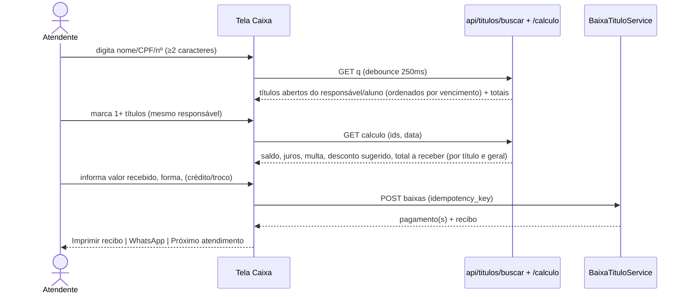

# PRD — Auditoria, Correções e Completude do Módulo Financeiro i-Educar

| Campo | Valor |
|---|---|
| **Repositório** | `douglas14031999/i-educar-financeiro-package` (branch `main`, HEAD `188ad48`) |
| **Data da auditoria** | 14/10/2026 |
| **Executor alvo** | Antigravity (agente de código) |
| **Stack** | PHP ≥ 8.3 · Laravel 12 (package) · PostgreSQL (schema `financeiro`) · i-Educar 2.10 (host) · Asaas v3 |
| **Tipo de documento** | PRD de correção + completude (substitui a visão de `PRD.md` v2.0 apenas onde houver conflito; os requisitos FR-01..FR-05 daquele documento continuam válidos e são auditados aqui) |
| **Método** | Leitura estática integral do código (≈ 18 mil linhas PHP/Blade): rotas, controllers, services, jobs, models, migrations, views, comandos, testes, CI, docs. **Nada foi executado** (sem banco, sem i-Educar host, sem chamadas ao Asaas). |

---

## 0. Como o Antigravity deve usar este documento

1. Leia as seções 1–3 para entender o estado atual e a gravidade.
2. Execute a **Fase 0 (§9)** antes de qualquer correção: ela valida as premissas marcadas como `[VALIDAR]`.
3. Trabalhe **na ordem das fases** (§9). Cada tarefa referencia IDs de defeito (`BUG-xxx`) ou funcionalidade (`FEAT-xx`) do catálogo (§5 e §6), com arquivo, correção exigida e critério de aceite.
4. **Uma tarefa = um commit** (`fix(BUG-004): ...` / `feat(FEAT-03): ...`) com testes.
5. Respeite as **regras do agente (§12)** — especialmente: **nunca editar migrations já aplicadas**; criar novas, idempotentes.
6. Ao concluir cada fase, rode a checklist de regressão (§10) e atualize `TALKS.md`/`TASKS.md`.

**Legenda de confiança**
- `[CONFIRMADO]` — comprovado por leitura direta do código/migrations neste repositório.
- `[VALIDAR]` — depende do ambiente (versão do Carbon, esquema real do i-Educar, API do Asaas, estado do banco da VPS). A Fase 0 indica como verificar; a correção proposta é segura mesmo se a premissa se confirmar apenas parcialmente.

**Severidade**
- **P0** — bloqueia fluxo principal, perde/corrompe dinheiro ou expõe dados. Corrigir antes de qualquer uso em produção.
- **P1** — fluxo funciona parcialmente, gera inconsistência, retrabalho ou risco moderado.
- **P2** — qualidade, UX, manutenção, desempenho.
- **P3** — documentação/limpeza.

---

## 1. Resumo executivo

O módulo tem boa base de domínio (cálculo de rateio com *largest remainder*, `lockForUpdate` na baixa, idempotência de webhook por `event_id`, soft deletes, UI coerente com o padrão i-Educar). Porém, **vários fluxos centrais não funcionam ou funcionam só no "caminho feliz"**, e há **lacunas graves de segurança**.

### 1.1 Os 12 achados mais críticos (P0)

| # | ID | Achado | Efeito para o usuário |
|---|---|---|---|
| 1 | BUG-001 | `TituloController@emitirLoteAsaas` usa `AsaasIntegrationService`, **classe inexistente** | Botão "Emitir no Asaas" da barra de lote → erro fatal 500 |
| 2 | BUG-002 | Emissão por competência chama `GerarCobrancasGatewayLoteJob::dispatch('asaas', $comp, $escola)`, mas o construtor aceita só `array $tituloIds`; job ainda ignora credenciais do banco | Emissão em massa nunca executa corretamente |
| 3 | BUG-003 | **Carnê Asaas (installments)** nunca persiste: `CobrancaGateway::create()` sem `gateway_charge_id` (coluna `NOT NULL UNIQUE`) → exceção **depois** de criar o parcelamento no Asaas; webhook não mapeia pagamentos do parcelamento; seleção de títulos ignorada | Carnê cai no fallback HTML; cada tentativa cria **novo parcelamento duplicado** no Asaas; pagamentos do carnê não baixam o título |
| 4 | BUG-004 | `BaixaTituloService` usa `CreditoResponsavel` (**model/tabela/coluna inexistentes**) | Qualquer pagamento a maior (comum no balcão) → exceção e baixa abortada |
| 5 | BUG-005 | Baixa permitida em título `renegociado` | Pagamento vira "crédito" indevido; dinheiro sem destino |
| 6 | BUG-006 | `ContaPagarController@store` grava `escola_id = null`; coluna é `NOT NULL` e o form não tem o campo | **Contas a Pagar não consegue criar nenhuma despesa** |
| 7 | BUG-007 | Cadastro rápido de responsável grava `null` em colunas `NOT NULL` (email, telefone, endereço) | Fluxo "Novo Contrato → cadastrar responsável" quebra quando o i-Educar não tem esses dados |
| 8 | BUG-008 | 6 rotas de `resource` sem método no controller (`planos.edit/update`, `contratos.edit/update/destroy`, `contas-pagar.show`) | Erro 500 ao acessar URL/rota |
| 9 | BUG-009 | `vincularOuCriarResponsavel` força 100% ao novo vínculo sem ajustar os demais; `ContratoService` exige soma = 100% | Segundo responsável → soma 200% → **contrato não pode ser criado** |
| 10 | BUG-010 | **Nenhuma autorização** nos controllers; migrations/comando concedem os menus a **todos os perfis** | Qualquer usuário logado (ex.: professor) acessa financeiro, CPFs, baixas, estornos |
| 11 | BUG-011 | Webhook aceita requisição **sem token** e "aprende" o token do 1º chamador | Qualquer pessoa na internet pode forjar "pagamento recebido" e baixar títulos |
| 12 | BUG-012 | API key do Asaas **em texto puro** no banco e **devolvida no HTML** da tela de configuração | Vazamento de credencial financeira |

### 1.2 Problemas estruturais
- **Navegação cruzada (FR-05) não implementada**: nenhum botão "Criar contrato / Ver mensalidades / Renegociar" na ficha do responsável; "Ver títulos do contrato" e "Renegociar" ausentes (BUG-018).
- **Caixa (balcão) não cumpre o critério de aceite** "localizar o título instantaneamente": lista fixa de 50 títulos mais antigos, sem busca; valor pré-preenchido incoerente com juros/multa (BUG-017).
- **Integração com matrícula do i-Educar não está ligada**: os listeners existem mas **não são registrados** em lugar nenhum (BUG-014).
- **Rotinas automáticas não agendadas** e comando de sincronização é *stub* (BUG-027).
- **Testes não executam**: `Tests\TestCase` não existe; testes "unitários" testam cópias privadas das fórmulas, não o código real; CI duplicado e conflitante (BUG-036).

### 1.3 O que NÃO precisa ser refeito (preservar)
Algoritmo `distribuirComResiduo`, `lockForUpdate` em `realizarBaixa`/`estornarBaixa`, tabela `webhook_events` (idempotência), `Titulo::isLiquidado/isVencido` (semântica A21/A22), validação de CPF/CNPJ, layout/visual i-Educar (paleta `#47728f`, sem roxo), migrations de menu idempotentes (com a correção de permissões em BUG-010).

---

## 2. Arquitetura atual (as-is)

```
src/
  FinanceiroServiceProvider.php   → carrega migrations, routes/web.php + routes/api.php, views (financeiro::), View composer de menu
  Http/Controllers/               → Dashboard, Responsavel, Plano, Contrato, Titulo, BaixaManual, Renegociacao,
                                    ContaPagar, Relatorio, GatewayConfig, ReguaCobranca, AlunoBusca (API JSON)
  Http/Webhooks/AsaasWebhookController.php
  Http/Middleware/CompartilharMenuMiddleware.php (só compartilha menu/breadcrumb; NÃO autoriza)
  Services/                       → Baixa, Contrato, Desconto, Inadimplencia, Regua, Renegociacao
  Gateways/                       → GatewayManager + Drivers/AsaasGateway (+ Contracts/GatewayInterface)
  Jobs/                           → ProcessarWebhook, GerarCobrancasGatewayLote, CancelarCobrancaGateway, EnviarNotificacaoCobranca
  Listeners/ + Events/            → CriarContratoAposMatricula, CancelarTitulosMatriculaCancelada (NÃO registrados), TituloPago
  Commands/                       → financeiro:processar-regua, financeiro:sincronizar-asaas (stub), financeiro:sincronizar-menus
  Models/ (20)                    → schema financeiro.*
database/migrations/ 000001..000014
resources/views/                  → layouts, partials (subnav, page-header, styles), 12 pastas de telas
routes/web.php (autenticado) · routes/api.php (webhooks públicos, middleware `api`)
```

### 2.1 Modelo de dados (financeiro.*)
`responsaveis_financeiros` ⟷ `aluno_responsavel` (rateio %) · `planos` → `plano_itens` · `contratos` → `titulos` → `pagamentos` · `titulos` → `cobrancas_gateway` (1:1 via `hasOne`) · `renegociacoes` ⟷ `renegociacao_titulos` · `lancamentos` (despesas) · `plano_contas`, `centros_custo`, `contas_bancarias` · `descontos_convenios`, `titulo_descontos` (**não usada**) · `regua_cobranca_regras`, `regua_envio_logs` · `webhook_events` · `gateway_configuracoes`.
Dependências do host i-Educar: `pmieducar.aluno/matricula/matricula_turma/turma/escola/curso/serie`, `cadastro.pessoa/fisica/v_endereco/v_fone_pessoa`, `menus`, `menu_tipo_usuario`.

---

## 3. Mapa de telas, botões e relação entre telas (auditoria de fluxos)

### 3.1 Matriz tela → ação → rota → situação

Legenda: ✅ funciona · ⚠️ funciona com defeito · ❌ quebrado · ➖ ausente (exigido)

| Tela | Ação / Botão | Rota / Destino | Situação | Ref. |
|---|---|---|---|---|
| **Dashboard** | Abas Todos/Atrasados/Pendentes/Pagos | `dashboard?filtro=` | ⚠️ carrega *todos* os títulos em memória; GET executa `UPDATE` | BUG-022 |
| | Baixa (ícone) | `baixas.create?titulo_id` | ✅ | |
| | WhatsApp (ícone) | `titulos.notificar-whatsapp` (`target=_blank`) | ⚠️ erro aparece na nova aba | BUG-033 |
| | Recibo / Ver | `titulos.recibo-pdf` / `titulos.show` | ✅ | |
| | Atalhos relatórios/planos/responsável/config | várias | ✅ | |
| **Mensalidades (titulos.index)** | Filtros status/competência/busca | `titulos.index` | ⚠️ sem filtro por responsável/contrato/aluno/ano/turma | BUG-018 |
| | Selecionar + **Emitir no Asaas** | `titulos.emitir-lote-asaas` (POST `titulo_ids`) | ❌ classe inexistente | BUG-001 |
| | Selecionar + **Imprimir Carnê** | `titulos.imprimir-carne?titulo_ids=` | ⚠️ ignora a seleção quando há 1 contrato (gera carnê do contrato inteiro) | BUG-003/019 |
| | **Sincronizar Asaas (lote)** | — | ➖ (exigido por FR-03) | BUG-019 |
| | Baixa / WhatsApp / Recibo / Ver | rotas de título | ✅/⚠️ | |
| | Novo Contrato / Caixa | `contratos.create` / `baixas.create` | ✅ | |
| **Título (show)** | Emitir Asaas | `titulos.emitir-asaas` | ⚠️ re-emissão duplica cobrança no Asaas | BUG-016 |
| | Sincronizar | `titulos.sincronizar-asaas` | ⚠️ ok no caminho feliz | BUG-032 |
| | Baixa / Recibo / WhatsApp / Estornar | rotas | ⚠️ baixa com excedente falha; estorno ok | BUG-004 |
| | **Renegociar (se vencido)** | — | ➖ (FR-05) | BUG-018 |
| **Caixa (baixas.create)** | Selecionar título | `baixas.create?titulo_id` | ⚠️ só 50 mais antigos, sem busca | BUG-017 |
| | Confirmar recebimento | `baixas.store` → `recibo-pdf` | ⚠️ valor/juros/multa incoerentes; sem proteção a duplo envio | BUG-017 |
| **Responsáveis** | Listar/Criar/Editar | resource | ⚠️ unique + soft delete; `ativo` não editável | BUG-025 |
| | Excluir | `responsaveis.destroy` | ➖ sem botão; regra só bloqueia `aberto` | BUG-025 |
| | Vincular/Desvincular aluno | `vincular-aluno` / `desvincular-aluno` | ⚠️ não permite editar % ; lista de 50 alunos sem busca | BUG-009/025 |
| | **Criar contrato / Ver mensalidades / Renegociar** | — | ➖ (FR-05) | BUG-018 |
| **Planos** | Criar / Ver / Excluir | resource | ⚠️ >12 parcelas colide competência; `escola_id` livre (default 1) | BUG-024 |
| | **Editar** | `planos.edit/update` | ❌ método inexistente | BUG-008 |
| **Contratos** | Listar / Criar / Ver | resource | ⚠️ planos só do ano corrente; `responsavel_financeiro_id` do form ignorado | BUG-023 |
| | Cadastro rápido de responsável (modal) | `api.responsaveis.vincular-ou-criar` | ❌ NOT NULL / rateio | BUG-007/009 |
| | Imprimir carnê | `contratos.imprimir-carne` | ❌ ver BUG-003 | |
| | Regenerar carnê | `contratos.carne-asaas` | ➖ sem botão; descarta registro sem cancelar no Asaas | BUG-003 |
| | Gerar títulos faltantes | `contratos.gerar-titulos` | ➖ sem botão; duplica lógica do service | BUG-023 |
| | Cancelar contrato | `contratos.cancelar` | ⚠️ não cancela parcelamento Asaas | BUG-023/031 |
| | Editar / Excluir | `contratos.edit/update/destroy` | ❌ método inexistente | BUG-008 |
| | **Ver títulos do contrato** | — | ➖ (FR-05) | BUG-018 |
| **Renegociação** | Selecionar responsável → títulos → Simular → Confirmar | `renegociacao.*` | ⚠️ ver BUG-020 | |
| | Termo | `renegociacao.termo-pdf` | ✅ (HTML, não PDF) | BUG-037 |
| **Contas a Pagar** | Listar / Editar / Liquidar / Excluir | resource | ⚠️ liquidar não atualiza saldo; excluir sem botão | BUG-026 |
| | **Nova despesa** | `contas-pagar.store` | ❌ `escola_id` NOT NULL | BUG-006 |
| | Ver (show) | `contas-pagar.show` | ❌ método inexistente | BUG-008 |
| **Relatórios** | Inadimplência / Fluxo / DRE / IRPF / Quitação | `relatorios.*` | ⚠️ DRE soma encargos em duplicidade; IRPF sem nome do aluno | BUG-021 |
| **Configurações** | Gateway (salvar / testar conexão) | `configuracoes.gateway*` | ⚠️ chave exposta em HTML | BUG-012 |
| | Régua (editar / executar manual) | `configuracoes.regua*` | ⚠️ WhatsApp via endpoint Asaas não confirmado | BUG-027 |
| | Notificações (histórico) | `notificacoes.index` | ✅ | |
| **Sub-navbar** | 5 grupos (Cadastros, Movimentações, Lançamentos, Relatórios, Configurações) | — | ✅ visual; ⚠️ diverge do PRD v2 (10 itens planos) | BUG-037 |

### 3.2 Relação entre telas — fluxos ponta a ponta e onde quebram

```
MATRÍCULA (i-Educar) ──╳── [listener não registrado: BUG-014] ──► Contrato automático
        │
Responsável ──► (sem botão) ──╳──► Novo Contrato ──► Contrato(show) ──► Títulos
   ▲                                    │  cadastro rápido ❌ (BUG-007/009)      │
   │                                    └─ carnê ❌ (BUG-003)                     ├─► Emitir Asaas (BUG-016)
Renegociação ◄──(sem botão)── Título(show) ◄── Dashboard / Lista ◄────────────────┤
   │                              │                                               ├─► Caixa ──► Recibo
   └─► novos Títulos ◄────────────┘                                               └─► WhatsApp
Webhook Asaas ──► baixa automática (inseguro BUG-011; carnê não mapeia BUG-003)
```

Quebras de fluxo confirmadas: (a) matrícula→contrato; (b) responsável→contrato/mensalidades/renegociação; (c) título vencido→renegociar; (d) contrato→títulos; (e) carnê→pagamento→baixa; (f) lote→emissão; (g) contrato com 2 responsáveis.

---

## 4. Premissas a validar (Fase 0)

| ID | Premissa `[VALIDAR]` | Como verificar | Impacto se verdadeira |
|---|---|---|---|
| V-01 | `nesbot/carbon` instalado é 3.x (`diffInDays` é **assinado**) | `composer show nesbot/carbon` no host | `Titulo::getDiasAtrasoAttribute()` retorna negativo → juros sempre 0 (BUG-013) |
| V-02 | `pagamentos.valor_credito_gerado` e tabela `creditos_responsavel` **não existem** (nenhuma migration cria) | `\d financeiro.pagamentos`; `\dt financeiro.*` | BUG-004. A VPS pode ter ajuste manual → migration nova deve ser idempotente (`Schema::hasColumn/hasTable`) |
| V-03 | `cadastro.fisica.cpf` é numérico (`numeric(11)`) no i-Educar 2.10 | `\d cadastro.fisica` | `f.cpf LIKE '%..%'` falha no PostgreSQL (BUG-034) |
| V-04 | Colunas `cadastro.fisica.nome_mae/nome_pai/nome_responsavel`, views `cadastro.v_endereco`, `cadastro.v_fone_pessoa` existem na versão do host | `\d` correspondentes | `AlunoBuscaController@detalhes` pode quebrar (BUG-034) |
| V-05 | Parâmetros do `POST /v3/installments` aceitos (`installmentCount`, `installmentValue` vs `totalValue`, ausência de `value`) e comportamento do `paymentBook` | Documentação oficial Asaas + teste em sandbox | Desenho do carnê (BUG-003) |
| V-06 | Endpoint `POST /v3/messages/whatsapp` **não consta** na API pública do Asaas | Documentação Asaas | Régua via WhatsApp pode nunca ter funcionado (BUG-027) |
| V-07 | Há *queue worker* ativo na VPS (jobs `ShouldQueue`) | `supervisorctl status`, `QUEUE_CONNECTION` | Sem worker: webhook nunca baixa título; régua nunca envia (BUG-011/027) |
| V-08 | Esquema de permissões do i-Educar: `menu_tipo_usuario(menu_id, tipo_usuario_id, cadastra, visualiza, exclui)` e como o host expõe o nível do usuário | Ler `app/` do host (`Menu`, `MenuCacheService`, `Process`/`Gate`) | Implementação de BUG-010 |
| V-09 | Estado real do banco da VPS (colunas já alteradas manualmente) | `pg_dump --schema-only -n financeiro` | Evitar migration que falhe por duplicidade |
| V-10 | Há registros com `escola_id`/`email`/etc. nulos já gravados | consultas `COUNT(*)` por coluna | Backfill nas migrations de relaxamento |

> **Entregável da Fase 0:** um arquivo `docs/FASE0-VALIDACAO.md` com o resultado de V-01..V-10 (comando executado + saída) e ajuste das tarefas conforme o resultado.

---

## 5. Catálogo de defeitos

Formato: **Local** · **Evidência** · **Impacto** · **Correção exigida** · **Aceite**.

### 5.1 P0 — Bloqueantes

#### BUG-001 — Emissão em lote por seleção usa classe inexistente `[CONFIRMADO]`
- **Local:** `src/Http/Controllers/TituloController.php::emitirLoteAsaas()` (referencia `iEducar\Financeiro\Services\AsaasIntegrationService`, método `emitirCobrancaTitulo`). Não existe em `src/Services/`.
- **Impacto:** o botão principal da barra flutuante de lote gera `Class not found` (500).
- **Correção:**
  1. Remover a dependência; usar `GatewayManager->driver('asaas')->criarCobranca($titulo)`.
  2. Filtrar apenas títulos emissíveis: `status IN (aberto, parcial, vencido)`, `valor_saldo > 0`, **sem cobrança ativa** (ver BUG-016), responsável com CPF/CNPJ válido.
  3. Até **10** títulos: processar síncrono com *timeout budget*; acima disso, `GerarCobrancasGatewayLoteJob` (BUG-002) e retornar mensagem "processamento em segundo plano".
  4. Retorno detalhado por título (sucesso / ignorado + motivo / erro + mensagem), exibido em painel de resultado (não só contagem).
  5. Auditoria: `Log::info` com `usuario_id`, IP, quantidade, IDs.
- **Aceite:** selecionar 3 títulos válidos → 3 cobranças criadas (`cobrancas_gateway` com `gateway_charge_id`); 1 título já emitido → listado como "ignorado: já possui cobrança"; título sem CPF → listado com erro claro; nenhuma exceção não tratada.

#### BUG-002 — Emissão por competência: job incompatível, ignora credenciais do banco, sem UI `[CONFIRMADO]`
- **Local:** `TituloController@emitirLoteAsaas` (ramo `competencia`) × `Jobs/GerarCobrancasGatewayLoteJob.php`.
- **Evidência:** controller chama `dispatch('asaas', $competencia, $escolaId)`; construtor é `__construct(array $tituloIds)` → `TypeError`. O job instancia `new AsaasGateway(config('financeiro.gateways.asaas'))` (só `.env`), ignorando `gateway_configuracoes` (que é a fonte de verdade desde A16). Não existe campo/tela para informar `competencia` no ramo global.
- **Correção:**
  1. Redefinir o job: `__construct(string $competencia, ?int $escolaId, ?int $usuarioId)`; resolver títulos em *chunks* (`chunkById(100)`).
  2. Obter o driver via `app(GatewayManager::class)->driver('asaas')`.
  3. Pular títulos com cobrança ativa; `tries=3`, `backoff` exponencial; tratar HTTP 429 (ver BUG-032).
  4. Registrar resumo em tabela `financeiro.lotes_processamento` (id, tipo, parametros jsonb, total, sucesso, falha, ignorados, status, usuario_id, iniciado_em, finalizado_em, erros jsonb) e exibir em `notificacoes`/nova tela "Processamentos".
  5. UI: na lista de títulos, ação "Emitir competência inteira" (modal com competência + escola) → POST.
- **Aceite:** competência com 120 títulos → job em fila, `lotes_processamento` ao final com contadores corretos; reexecução não duplica cobranças.

#### BUG-003 — Carnê via Asaas Installments não funciona de ponta a ponta `[CONFIRMADO]` `[VALIDAR V-05]`
Sub-defeitos (todos devem ser tratados no redesenho da §7.2 / FEAT-01):
| Sub | Defeito | Evidência |
|---|---|---|
| a | `CobrancaGateway::create([...])` sem `gateway_charge_id`, coluna `NOT NULL UNIQUE` → exceção **após** o Asaas já ter criado o parcelamento; `installment_id` se perde; **cada nova tentativa cria outro parcelamento** | `ContratoController@imprimirCarne`, migration 000006 (`gateway_charge_id` não nulo) e 000014 (não altera) |
| b | Pagamentos gerados pelo parcelamento **não são vinculados** a nenhum `titulo` (não se consulta `GET /installments/{id}/payments`) | `AsaasGateway::criarInstallment` |
| c | `paymentExternalReference = 'CTR-{id}'` é **não numérico**; o webhook só resolve por `externalReference` numérico (`ProcessarWebhookJob`) → "Cobrança não localizada" | `ProcessarWebhookJob` |
| d | O Asaas divide **valores iguais** e datas **mensais** a partir do 1º vencimento; o código usa média dos saldos e 1ª data → valores/datas diferem dos títulos locais (matrícula + mensalidades, centavos, vencimentos distintos) | `criarInstallment` |
| e | Seleção na lista é **ignorada**: com 1 contrato, delega a `ContratoController@imprimirCarne($cid)` que usa **todos** os títulos abertos do contrato | `TituloController@imprimirCarne` |
| f | Títulos que já têm cobrança individual entram no parcelamento → **cobrança em duplicidade** | idem |
| g | `carne_url` salvo é URL **da API** (exige `access_token`); `redirect()->away($carneUrl)` leva o navegador a uma URL inacessível. `gerarCarneUrl` ainda baixa o PDF inteiro só para obter URL | `gerarCarneUrl` |
| h | `carneAsaas` apaga o registro local sem cancelar o parcelamento antigo no Asaas | `ContratoController@carneAsaas` |
| i | `$resultado` indefinido quando já havia `installment_id` e o PDF vem vazio (notice/ErrorException) | `imprimirCarne` |
| j | Títulos vencidos entram no parcelamento (Asaas exige vencimento ≥ hoje) | `criarInstallment` |
| k | `hasOne cobrancaGateway` (1:1) conflita com o registro "âncora" do carnê no primeiro título | `Titulo`, `imprimirCarne` |
- **Correção:** implementar **FEAT-01 (Carnê Asaas robusto)** — §7.2.
- **Aceite:** ver FEAT-01.

#### BUG-004 — Baixa com excedente referencia model/tabela/coluna inexistentes `[CONFIRMADO]` `[VALIDAR V-02]`
- **Local:** `Services/BaixaTituloService.php` (`use ...\CreditoResponsavel`; grava `valor_credito_gerado`; no estorno `CreditoResponsavel::where(...)->update(['cancelado' => true])`).
- **Evidência:** não há `src/Models/CreditoResponsavel.php`, nenhuma migration cria `creditos_responsavel` nem `pagamentos.valor_credito_gerado`, e `Pagamento::$fillable` não inclui `valor_credito_gerado` (o campo é silenciosamente descartado no caminho normal — por isso a baixa "normal" funcionou na VPS). Se `amortizacao > saldo` → `Class not found` → rollback.
- **Correção:**
  1. Migration `create_creditos_responsavel`: `id, responsavel_financeiro_id (FK), pagamento_id (FK), valor decimal(14,2), origem, descricao, utilizado bool default false, cancelado bool default false, utilizado_em, titulo_utilizado_id null, timestamps`. Índices em `responsavel_financeiro_id`, `pagamento_id`.
  2. Migration `add_valor_credito_gerado_to_pagamentos` (`decimal(14,2) default 0`) + incluir em `$fillable` e `$casts` de `Pagamento`.
  3. Criar `Models/CreditoResponsavel`.
  4. **Aplicação do crédito:** novo método `BaixaTituloService::aplicarCredito(Titulo, CreditoResponsavel)` e opção na tela de Caixa "Usar crédito disponível (R$ x)". Exibir crédito no `responsaveis/show`.
  5. Decisão de UX no balcão: quando valor recebido > devido, a tela pergunta "Gerar crédito" ou "Devolver troco" (troco não gera crédito; registrar `troco` no pagamento).
- **Aceite:** pagar R$ 110 em título de R$ 100 → pagamento criado, título `pago`, 1 crédito de R$ 10 vinculado; estornar o pagamento cancela o crédito (se não utilizado); se já utilizado, estorno é bloqueado com mensagem.

#### BUG-005 — Baixa permitida em título `renegociado` `[CONFIRMADO]`
- **Local:** `BaixaTituloService::realizarBaixa()` bloqueia só `pago` e `cancelado`. `renegociado` tem `valor_saldo = 0` → todo valor pago vira "excedente".
- **Também:** `ProcessarWebhookJob` e `TituloController@sincronizarStatus` chamam a baixa sem checar status.
- **Correção:** bloquear `renegociado`, `cancelado`, `pago` com exceção de domínio específica (`TituloNaoBaixavelException`). Cobrança Asaas ativa de título renegociado/cancelado deve ser **cancelada** (BUG-020/031); se mesmo assim pagar, o webhook registra o evento como **"pagamento órfão"** (`webhook_events.erro`, flag `requer_acao`) e gera alerta na tela de Processamentos — não cria crédito automático.
- **Aceite:** tentativa de baixa (manual, webhook, sync) em `renegociado` falha/é sinalizada sem alterar valores.

#### BUG-006 — Contas a Pagar não grava `[CONFIRMADO]`
- **Local:** `ContaPagarController@store`: `$dados['escola_id'] = $request->input('escola_id') ? (int)... : null;` · migration 000006: `lancamentos.escola_id integer NOT NULL` · `contas-pagar/create.blade.php` **não tem** campo `escola_id`.
- **Impacto:** `SQLSTATE[23502]` em toda criação de despesa.
- **Correção:** (a) adicionar `<select name="escola_id">` alimentado por `pmieducar.escola` (com opção "Todas/Geral" se decidido tornar nullable — **Decisão D-05**); (b) validar `escola_id` (`required|integer`); (c) se D-05 = nullable, migration idempotente `ALTER COLUMN escola_id DROP NOT NULL`; (d) filtrar listagem/relatórios por escola.
- **Aceite:** criar despesa pela tela → registro gravado; teste de feature cobre.

#### BUG-007 — Cadastro rápido de responsável viola `NOT NULL` `[CONFIRMADO]`
- **Local:** `AlunoBuscaController@vincularOuCriarResponsavel` grava `null` em `email, telefone_celular, cep, logradouro, numero, bairro, cidade, estado` · migration 000003 declara todos `NOT NULL`.
- **Correção:** migration de relaxamento idempotente tornando **nullable**: `email`, `telefone_celular`, `cep`, `logradouro`, `numero`, `bairro`, `cidade`, `estado` (mantém `nome` e `cpf_cnpj` obrigatórios). Introduzir `ResponsavelFinanceiro::cadastroCompleto(): bool` e **guardas por finalidade**: emitir cobrança Asaas exige `nome` + `cpf_cnpj` válido (Asaas não exige endereço); WhatsApp exige celular; e-mail exige email. As telas `responsaveis.create/edit` continuam exigindo cadastro completo (regra de UI), o cadastro rápido não.
- **Aceite:** pelo modal do contrato, cadastrar responsável com apenas nome+CPF → sucesso; badge "cadastro incompleto" na ficha; emissão no Asaas funciona; WhatsApp informa "sem celular".

#### BUG-008 — Rotas de `resource` sem método `[CONFIRMADO]`
| Rota | Ação requerida |
|---|---|
| `planos.edit` / `planos.update` | **Implementar** edição (nome, descrição, ativo; edição de itens apenas se **não houver contratos** vinculados) — FEAT-08 |
| `contratos.edit` / `contratos.update` | **Implementar** edição limitada (dia de vencimento das parcelas **futuras abertas**, responsável principal, observações) com recálculo seguro — FEAT-09 |
| `contratos.destroy` | **Remover rota** (`->except(['destroy','edit','update'])` se FEAT-09 não for feita); cancelamento é via `contratos.cancelar` |
| `contas-pagar.show` | **Implementar** tela de detalhe ou `->except('show')` |
- **Regra geral:** nenhuma rota registrada pode apontar para método inexistente. Adicionar teste que percorre `Route::getRoutes()` do pacote e valida `method_exists`.
- **Aceite:** teste "todas as rotas do pacote resolvem para método existente" verde.

#### BUG-009 — Rateio entre responsáveis incoerente `[CONFIRMADO]`
- **Local:** `AlunoBuscaController@vincularOuCriarResponsavel` (sempre `percentual_rateio = 100` + zera `responsavel_principal` dos demais, **sem tocar nos %**) · `ResponsavelFinanceiroController@vincularAluno` (`validarSomaRateio` não passa `ignorarVinculoId` → não dá para **editar** %; `responsavel_principal` default `true` para todos) · `ContratoService` exige soma **exatamente** 100%.
- **Efeitos:** (1) vincular 2º responsável pelo modal → soma 200% → contrato impossível; (2) vincular 1º responsável com 50% (permitido pela validação `≤100`) → contrato impossível até completar; (3) vários "principais".
- **Correção:**
  1. Criar `Services/RateioResponsavelService` com `definirRateio(int $alunoId, array [responsavel_id => percentual])` transacional: valida soma = 100,00, exatamente **um** principal, percentuais > 0.
  2. Modal do contrato: ao adicionar responsável a aluno que já tem vínculo, abrir mini-tela "Distribuir rateio" (padrão: dividir igualmente, ajustável) — ou manter como único se for o único.
  3. `responsaveis/show`: permitir **editar %** do vínculo (inline) e marcar principal (radio).
  4. `ContratoService` deve **falhar com mensagem acionável** com link "Ajustar rateio do aluno".
  5. Constraint: índice único parcial `aluno_responsavel(aluno_id, responsavel_id) WHERE deleted_at IS NULL`; índice único parcial `(aluno_id) WHERE responsavel_principal AND deleted_at IS NULL`.
- **Aceite:** aluno com pai/mãe 50/50 gera 2 títulos por parcela somando o valor da parcela ao centavo; alterar para 70/30 funciona; soma ≠ 100 bloqueia com mensagem.

#### BUG-010 — Ausência de autorização (RBAC) e permissões concedidas a todos `[CONFIRMADO]` `[VALIDAR V-08]`
- **Evidência:** `CompartilharMenuMiddleware` só monta menu/breadcrumb; nenhum controller/rota verifica permissão. `TRD.md §4.1` afirma validar `pmieducar.menu_processo`, **o que não existe no código**. As migrations `000010/000011` e `SincronizarMenusCommand` inserem permissão para **todos os tipos de usuário** (`pmieducar.tipo_usuario`, `tipo_usuario`, `menu_tipo_usuario`).
- **Impacto:** qualquer usuário autenticado (professor, secretário sem perfil financeiro) acessa PII (CPF, endereço, telefone), baixa, estorno, renegociação, despesas e API key.
- **Correção:**
  1. Criar `Http/Middleware/AutorizarProcessoFinanceiro` com sintaxe `financeiro.can:{PROCESSO},{nivel}` onde `nivel ∈ {visualiza, cadastra, exclui}`; consulta o mecanismo do host (descobrir na Fase 0 via V-08; fallback: `menu_tipo_usuario` pelo `menu_id` do `process` e `tipo_usuario` do usuário; administrador/institucional sempre permitido). Cachear por request.
  2. Aplicar por rota (matriz abaixo). Retornar 403 com view padrão (não redirecionar silenciosamente).
  3. Esconder botões/itens de menu sem permissão (`@can`-like helper `financeiro_can()`).
  4. **Reescrever as migrations de permissão por NOVA migration** que: remove permissões financeiras concedidas indiscriminadamente (somente para menus `process ∈ 999950..999960`) **exceto** perfis administrativos, e passa a conceder apenas ao(s) perfil(is) configurado(s) em `config('financeiro.perfis_padrao')` (default: administrador/institucional). `SincronizarMenusCommand` ganha `--perfis=` e **não** concede a todos por padrão.
  5. Proteger também `api/alunos/*` e `api/responsaveis/*` (processo `MENU_CONTRATOS`/`MENU_RESPONSAVEIS`, nível `visualiza`/`cadastra`).

  **Matriz mínima rota → processo → nível**
  | Grupo de rotas | Processo | GET | POST/PUT | DELETE / estorno / cancelamento |
  |---|---|---|---|---|
  | dashboard | `MENU_DASHBOARD` | visualiza | — | — |
  | responsaveis, vincular-aluno | `MENU_RESPONSAVEIS` | visualiza | cadastra | exclui |
  | planos | `MENU_PLANOS` | visualiza | cadastra | exclui |
  | contratos, carnê | `MENU_CONTRATOS` | visualiza | cadastra | exclui (cancelar) |
  | titulos, emitir/sincronizar/whatsapp | `MENU_TITULOS` | visualiza | cadastra | — |
  | baixas (store) | `MENU_BAIXA_MANUAL` | visualiza | cadastra | **exclui** (estornar) |
  | renegociacao | `MENU_RENEGOCIACAO` | visualiza | cadastra | — |
  | contas-pagar | `MENU_CONTAS_PAGAR` | visualiza | cadastra | exclui |
  | relatorios | `MENU_RELATORIOS` | visualiza | — | — |
  | configuracoes (gateway/regua), notificacoes | `MENU_GATEWAY_CONFIG` | visualiza | cadastra | — |
- **Aceite:** usuário de perfil sem permissão recebe 403 em todas as rotas e não vê o menu; teste de feature por perfil; estorno exige nível `exclui`.

#### BUG-011 — Webhook Asaas inseguro `[CONFIRMADO]`
- **Local:** `Http/Webhooks/AsaasWebhookController@handle`, `routes/api.php`.
- **Falhas:** (1) sem token configurado, aceita qualquer chamada (só `Log::notice`); (2) se não há token no banco mas chega um header, **grava o token recebido** (Trust-On-First-Use: um atacante pode "plantar" o token); (3) comparação `!==` não é *constant-time*; (4) não confere `payment.value`/status com o Asaas; (5) middleware `api` aplica *throttle* padrão (60/min) → rajadas legítimas do Asaas recebem 429 e a fila do Asaas pode ser **pausada**; (6) se `dispatch` falhar, o evento fica `processado=false` e **ninguém reprocessa**; (7) depende de *worker* (V-07).
- **Correção:**
  1. Token **obrigatório**: sem token configurado → `503` + log `critical`; **remover TOFU**. A tela de configuração gera/mostra o token (gerado aleatório de 32+ bytes) e exibe instrução de cadastro no painel Asaas. `hash_equals`.
  2. Defesa em profundidade: antes de baixar, `GET /payments/{id}` no Asaas e conferir `status ∈ {RECEIVED, CONFIRMED, RECEIVED_IN_CASH}` e `value` vs esperado (tolerância configurável); divergência → registrar evento "divergente" sem baixar.
  3. Rate-limit próprio (ex.: 600/min) via `RateLimiter::for('financeiro-webhook')`.
  4. Comando agendado `financeiro:reprocessar-webhooks` (a cada 5 min): reenfileira `webhook_events` com `processado=false` e `erro` não terminal (máx. 10 tentativas, coluna `tentativas`, `proxima_tentativa_em`).
  5. Se `QUEUE_CONNECTION=sync`/sem worker detectado (config `financeiro.webhook_sync_fallback=true`), processar com `dispatchSync`.
  6. Resolver cobrança por: `gateway_charge_id` → `externalReference` (`TIT-{id}` ou numérico legado) → `payment.installment` via `carnes_gateway` (BUG-003).
- **Aceite:** requisição sem token/token errado → 401/503 sem efeito; payload com `value` divergente → evento marcado, sem baixa; evento duplicado → `already_processed`; rajada de 200 eventos/min não retorna 429; reprocessamento recupera evento cujo dispatch falhou.

#### BUG-012 — API key em texto puro (banco e HTML) `[CONFIRMADO]`
- **Local:** `Models/GatewayConfiguracao` (sem cast `encrypted`; a migration 000012 **afirma** "criptografada via APP_KEY", o que é falso) · `configuracoes/gateway.blade.php` (`<input type="password" value="{{ api_key }}">`) · `GatewayConfigController@index` envia a chave completa à view.
- **Correção:**
  1. Casts `'api_key' => 'encrypted'`, `'webhook_token' => 'encrypted'`; migration de *backfill* que criptografa valores existentes (idempotente: detectar se já é payload cifrado).
  2. A view **nunca** recebe a chave: exibir máscara `••••••••XXXX` (últimos 4) e só atualizar quando o campo vier preenchido; botão "Testar conexão" usa a chave salva se o campo estiver vazio.
  3. `GatewayConfigController@salvar`: registrar auditoria (usuário, IP, ambiente) **sem** valores; exigir nível `cadastra` e reautenticação opcional ao trocar de `sandbox` para `production`.
  4. `testarConexao` não deve aceitar `api_key`/`base_url` arbitrárias vindas do cliente sem validar formato (evitar SSRF: `base_url` é derivada de `environment`, já ok — manter).
  5. Ocultar `ASAAS_API_KEY` de logs (`payload_requisicao` não deve conter token).
- **Aceite:** `SELECT api_key FROM financeiro.gateway_configuracoes` retorna valor cifrado; HTML da tela não contém a chave; testar conexão funciona sem redigitar.

### 5.2 P1 — Alta prioridade

#### BUG-013 — Dias de atraso podem sair negativos → juros sempre zero `[VALIDAR V-01]`
- **Local:** `Models/Titulo::getDiasAtrasoAttribute()` usa `Carbon::today()->diffInDays($vencimentoEfetivo)`. No Carbon 3 (Laravel 12) `diffInDays` é **assinado** e retorna negativo quando o argumento é anterior. Então `dias_atraso < 0` → `calcularJuros()` retorna 0 e `inadimplência` mostra atraso errado. Os testes não detectam porque testam **cópias** da fórmula (BUG-036).
- **Correção:** `(int) $vencimentoEfetivo->startOfDay()->diffInDays(Carbon::today(), false)` e `max(0, …)`; extrair para `Support/CalculoEncargos` (classe pura, com `dias_tolerancia` de config — BUG-035) usada por `Titulo`, `BaixaManualController` e relatórios; padronizar `data_prorrogacao` em **todos** os cálculos (hoje `InadimplenciaCheckService` usa só `data_vencimento`).
- **Aceite:** teste com título vencido há 15 dias, saldo 1000 → juros 5,00 (1% a.m. pro-rata/30) e multa 20,00; teste com `data_prorrogacao` futura → 0.

#### BUG-014 — Integração com matrícula não está ligada `[CONFIRMADO]`
- **Local:** `Listeners/CriarContratoAposMatricula`, `CancelarTitulosMatriculaCancelada` — nenhum `Event::listen`/`$listen`/`EventServiceProvider` os registra; README promete a integração. Além disso `CriarContratoAposMatricula` exige plano por `(ano, escola)` e responsável já vinculado, e **engole** exceções com `Log::warning`.
- **Correção:**
  1. Descobrir no host (Fase 0) os eventos/observers de matrícula do i-Educar (ex.: `App\Events\...`/observer em `App\Models\LegacyRegistration`). Registrar no provider com `Event::listen(...)` **configurável** (`config('financeiro.integracao_matricula.eventos')`), desabilitável (`FINANCEIRO_AUTO_CONTRATO=false`, default **false**).
  2. Se não existir evento no host: oferecer comando `financeiro:contratos-pendentes` (lista matrículas ativas sem contrato) e tela "Matrículas sem contrato" com ação "Criar contrato" (reusa `contratos.create` pré-preenchido). **Recomendado como padrão**, pois contrato exige escolha de plano/responsável.
  3. Falhas não podem ser silenciosas: gravar em `lotes_processamento`/tabela de pendências visível na UI.
  4. Cancelamento: respeitar `politica_cancelamento_matricula` (BUG-035) — hoje o service ignora a config.
  5. Registrar `TituloPago` também (hoje sem listener; documentar como ponto de extensão NFS-e).
- **Aceite:** com a flag ligada, matricular aluno com plano único da escola/ano e responsável vinculado cria contrato+parcelas; sem responsável → pendência visível; cancelar matrícula cancela parcelas futuras abertas e agenda cancelamento no Asaas.

#### BUG-016 — Re-emissão duplica cobrança no Asaas / guarda de status `[CONFIRMADO]`
- **Local:** `TituloController@emitirAsaas`, `AsaasGateway::criarCobranca` (`updateOrCreate(['titulo_id'])` substitui o `gateway_charge_id` anterior **sem cancelar** a cobrança antiga).
- **Correção:** (1) bloquear emissão quando `status ∈ {pago, cancelado, renegociado}`; (2) se já existe cobrança com status externo ativo (`PENDING`/`OVERDUE`/`AWAITING_RISK_ANALYSIS`) → exigir ação explícita **"Reemitir (cancela a anterior)"** que cancela a antiga via `cancelarCobranca` **antes** de criar a nova, tudo dentro de lock do título; (3) histórico: manter tabela `cobrancas_gateway` com várias linhas por título (campo `ativa bool`), `Titulo::cobrancaGateway()` passa a ser `hasOne(...)->where('ativa', true)->latestOfMany()` e `cobrancas()` `hasMany`; (4) valor da nova cobrança = `valor_saldo` (títulos vencidos: mesma política de BUG-032 sobre juros/multa).
- **Aceite:** emitir 2× o mesmo título não deixa duas cobranças ativas no Asaas; webhook de cobrança antiga cancelada é ignorado sem erro.

#### BUG-017 — Tela de Caixa não atende o critério "localizar instantaneamente" e tem cálculo incoerente `[CONFIRMADO]`
- **Local:** `BaixaManualController@create`, `baixas/create.blade.php`.
- **Falhas:** (1) lista fixa dos **50 títulos mais antigos** (`orderBy data_vencimento asc limit 50`) — em escolas com atrasados, os títulos do mês nunca aparecem; **não há busca**; (2) `valor_pago` pré-preenchido com `valor_saldo` enquanto `juros`/`multa` vêm calculados → pelo `BaixaTituloService` a amortização = pago + desconto − juros − multa < saldo → **título de vencido sempre fica `parcial`**; (3) `DescontoService` é injetado mas **nunca usado** — desconto de pontualidade nunca é sugerido; (4) sem recálculo dinâmico na tela; (5) sem proteção a duplo clique/duplo envio (baixa parcial duplicaria); (6) sem opção troco/crédito (BUG-004); (7) data futura aceita; (8) `forma_pagamento` validada só como `string` (aceita qualquer valor); (9) recibo pega `pagamentos()->first()` ordenado por data → pode exibir recibo de outro pagamento no mesmo dia.
- **Correção (ver FEAT-02):** busca incremental (aluno, responsável, CPF, nº do contrato/título), cálculo único no servidor via endpoint `GET api/titulos/{id}/calculo?data=` (saldo, juros, multa, desconto aplicável, **total a receber**), campo "Valor recebido" pré-preenchido com o **total a receber**, recálculo ao mudar data/desconto, `idempotency_key` (uuid hidden → `pagamentos.idempotency_key` UNIQUE), validação `in:` das formas, `data_pagamento <= hoje`, recibo por `pagamento_id` (`titulos.recibo-pdf?pagamento_id=`), pós-baixa com ações "Imprimir recibo", "Enviar recibo por WhatsApp", "Próximo atendimento".
- **Aceite:** localizar aluno por 3 letras e baixar em ≤ 30 s; título vencido quitado integralmente fica `pago`; reenviar o formulário com a mesma chave não cria segundo pagamento.

#### BUG-018 — Navegação cruzada (FR-05) e filtros contextuais ausentes `[CONFIRMADO]`
Implementar conforme **FEAT-03** (§6): botões e filtros por `responsavel_id`, `contrato_id`, `aluno` (id/busca), `ano`, `turma_id`; pré-preenchimento em `contratos.create?responsavel_id=`, `renegociacao.index?responsavel_id=&titulo_id=`.

#### BUG-019 — Ações em lote incompletas; carnê por seleção ignora a seleção `[CONFIRMADO]`
- **Falhas:** FR-03 pede "Sincronizar Status com Asaas" em lote — **não existe** (TRD cita `titulos.sincronizar-lote-asaas`; rota inexistente). Carnê "dos selecionados" ignora seleção quando todos são do mesmo contrato (BUG-003e). Seleção só vale na página atual (20 itens) e some ao paginar/filtrar. Impressão por `GET` com IDs na query pode estourar o limite de URL.
- **Correção:** rota `POST titulos/sincronizar-lote-asaas` (job em *chunks* + resultado); barra de lote exibe 3 ações reais; opção "Selecionar todos os N resultados do filtro" (envia filtro, não IDs) para ações assíncronas; `imprimir-carne` aceita `POST` e usa a seleção real (FEAT-01).

#### BUG-020 — Renegociação: concorrência, consistência e efeitos no gateway `[CONFIRMADO]`
- **Falhas em `Services/RenegociacaoService` / `RenegociacaoController`:**
  1. `confirmar()` chama `simular()` **fora** da transação e **sem `lockForUpdate`**: dois operadores podem renegociar os mesmos títulos; o teste `PagamentoDuranteRenegociacaoTest` descreve um comportamento ("invalidar proposta se título mudou") que **não está implementado**.
  2. `numero_acordo` por `count()+1` → colisão sob concorrência (usar sequence como em contratos).
  3. Novos títulos usam `aluno_id` e `contrato_id` do **primeiro** título; se os títulos pertencem a alunos/contratos diferentes do mesmo responsável, o acordo mistura alunos.
  4. Cobranças Asaas ativas dos títulos originais **não são canceladas** → família pode pagar o boleto antigo (BUG-005).
  5. Não inclui juros/multa acumulados no valor da dívida (opção `incluir_encargos`), nem cobra **entrada** (FLUXO.md prevê "entrada"; não implementada).
  6. Controller não restringe `titulos_ids` ao responsável escolhido; valida só `array|min:1`.
  7. Mensagens com erro de digitação ("renegocição"); `desconto_valor` sem teto percentual configurável.
  8. `confirmar` não registra o `snapshot` da simulação (assinatura/hash) → termo pode divergir.
- **Correção (FEAT-07):** transação única com `lockForUpdate` ordenado por id; reconferir `status` e `valor_saldo` contra o *hash* da simulação (`simulacao_hash` enviado no POST); sequence `financeiro.seq_acordos_{ano}`; agrupar parcelas por aluno quando necessário (um acordo por aluno **ou** exigir um aluno por acordo — **Decisão D-06**); cancelar cobranças dos originais via `CancelarCobrancaGatewayJob` pós-commit; opção "incluir encargos" e "entrada" (primeira parcela com data/valor próprios); `renegociacoes.status` evolui para `quitado` quando todas as parcelas novas forem pagas; inadimplência de parcela do acordo reabre/atualiza status (`quebrado`) — definir regra.
- **Aceite:** dois acordos simultâneos sobre o mesmo título → o segundo recebe erro claro; após acordo, boletos antigos aparecem como cancelados no Asaas; termo exibe valores idênticos à simulação.

#### BUG-021 — DRE e fluxo de caixa com conceitos misturados `[CONFIRMADO]`
- **Local:** `RelatorioFinanceiroController@dre` calcula `receitaBruta = Σ(valor_pago + valor_juros + valor_multa)`; mas `valor_pago` **já inclui** juros e multa (amortização = pago + desconto − juros − multa). Soma em duplicidade. `deducoes = Σ desconto` subtrai de um bruto que não contém o desconto.
- **Correção:** definir e documentar: `Receita bruta = Σ(valor_pago + valor_desconto_concedido)` (principal + encargos); `Deduções = Σ desconto`; `Receita líquida = Σ valor_pago`; detalhar linha "Juros e multas" = `Σ(juros + multa)`; *regime de caixa* (por `data_pagamento`) com opção de *competência*. Fluxo de caixa: incluir previsto (títulos a vencer por mês) vs realizado, e despesas por `data_pagamento`. Cobrir com testes de valores.
- **Aceite:** pagamento de R$ 100 nominal + R$ 3 de encargos (pago 103) → bruta 103, líquida 103, deduções 0; com desconto de 10 (pago 93) → bruta 103, deduções 10, líquida 93.

#### BUG-022 — Dashboard: escrita em GET, carga total em memória, status `vencido` não persistido `[CONFIRMADO]`
- **Falhas:** `DashboardController@index` executa `UPDATE titulos SET status='pago'` a cada acesso (efeito colateral em GET; esconde defeitos); no filtro "todos" carrega **todos** os títulos não cancelados e ordena em PHP (cresce sem limite); `taxa_inadimplencia` usa `Σ valor_nominal` de **todos** os vencimentos até o fim do mês (inclui já pagos) — denominador discutível; status `vencido` só é gravado pelo webhook `PAYMENT_OVERDUE`; demais telas dependem de scopes.
- **Correção:** remover o `UPDATE`; criar comando agendado `financeiro:atualizar-status` (diário 00:10) que (a) marca `vencido` onde `aberto/parcial` e vencimento efetivo < hoje, (b) corrige `valor_saldo<=0.005 → pago` **uma vez** com log do que foi corrigido (não silenciar); KPIs via agregações SQL (`SUM/COUNT` com `FILTER`), listagem com `paginate`/`limit` e `ORDER BY CASE`; cache curto (60 s) por escola; definir e documentar fórmulas dos KPIs (taxa = saldo vencido / total faturado com vencimento no período).
- **Aceite:** dashboard com 50 mil títulos responde < 500 ms; nenhuma query de escrita em GET.

#### BUG-023 — Contratos: lógica duplicada, validações, unicidade e cancelamento incompleto `[CONFIRMADO]`
1. `ContratoController@gerarTitulos` **reimplementa** a geração (ignora rateio de responsáveis, desconto proporcional, `total_parcelas` por item) → títulos divergem dos gerados pelo service. **Mover para `ContratoService::gerarTitulosFaltantes()`** reaproveitando o mesmo núcleo e expor botão no `contratos/show`.
2. `ContratoService`: quando `escola_id` é informado, **não valida** se a matrícula pertence ao aluno nem se existe; `valor_total_descontos` pode exceder o bruto (clamp silencioso em 0) — validar `0 ≤ desconto ≤ bruto`; `data_inicio/data_termino` do payload sem validação.
3. `responsavel_financeiro_id` do formulário é **ignorado** quando já existem vínculos (usa principal do rateio); sem aviso ao usuário.
4. Sem unicidade `(matricula_id, ano_letivo)` para contratos não cancelados → contratos duplicados (o teste `DuploSubmitContratoTest` fala de proteção que não está no banco). Criar índice único parcial + `lockForUpdate`/*advisory lock* por matrícula e **token de formulário** (idempotência de duplo clique).
5. Sem unicidade de título por `(contrato_id, responsavel_financeiro_id, tipo, numero_parcela)`.
6. `contratos.create` lista só planos do **ano corrente** (`date('Y')`) e 100 responsáveis — contratos de rematrícula (ano seguinte) ficam inviáveis. Permitir escolher `ano_letivo` e filtrar planos por escola/curso/série da matrícula.
7. `cancelarContrato`: não verifica se já está cancelado; não usa `lockForUpdate`; **cancela só `aberto`** (parcelas `parcial` futuras permanecem — definir regra); não cancela **parcelamento Asaas** (BUG-003/031); não registra usuário/data do cancelamento (adicionar `cancelado_em`, `cancelado_por`).
8. Plano alterado depois do contrato não afeta o contrato (correto) — mas `gerarTitulosFaltantes` usa itens atuais; congelar **snapshot** do plano em `contratos.plano_snapshot jsonb`.
- **Aceite:** gerar títulos faltantes não cria duplicatas e respeita rateio; criar 2 contratos para a mesma matrícula/ano falha com mensagem; cancelar contrato cancela cobranças Asaas das parcelas futuras (individuais e do parcelamento).

#### BUG-024 — Planos: competência, escola e edição `[CONFIRMADO]`
- `PlanoPagamentoController@store`: para `qtd_parcelas > 12`, `mesComp = i % 12` repete meses (ex.: parcela 13 → mês 1 do **mesmo ano**) → títulos com mesma competência/vencimento; parcelas começam sempre em **janeiro**; `escola_id` é campo numérico livre com default **1** (`create()` e view); matrícula avulsa sempre competência 1; `valor_total` não inclui a taxa de matrícula (item extra) → `qtd_parcelas` e totais inconsistentes com `recalcularValorTotal()`.
- **Correção:** campos `mes_inicial` (1–12) e `ano_offset` por item (permitir cruzar ano) ou limitar a 12 com validação; `escola_id` via `<select>` de `pmieducar.escola`; matrícula com `mes_competencia` configurável; plano exibe subtotal separado (matrícula / mensalidades); duplicar plano para novo ano (botão "Copiar para ano X") — FEAT-08.
- **Aceite:** plano de 12 parcelas iniciando em fevereiro gera competências 02..12 + 01 do ano seguinte (se `ano_offset` habilitado) ou bloqueia; nenhum item com competência repetida.

#### BUG-025 — Responsáveis: soft delete × unique, exclusão, ativação, vínculo `[CONFIRMADO]`
1. `cpf_cnpj` tem **unique no banco** mas o modelo usa `SoftDeletes`; verificações `exists()` ignoram excluídos → recriar CPF de um responsável excluído gera `23505`. → índice único **parcial** `WHERE deleted_at IS NULL` e/ou restaurar registro excluído (oferecer "Restaurar").
2. `destroy` só impede exclusão se houver título `aberto` (ignora `parcial`/`vencido`/contratos ativos/créditos).
3. Não há botão de exclusão/inativação na UI; `responsaveis/edit` **não tem campo `ativo`** (validação `ativo boolean` nunca é exercida).
4. `show` lista 50 alunos sem busca (`pmieducar.aluno`) e `hasTable('pmieducar.aluno')` pode retornar `false` por causa do schema qualificado; usar o endpoint `api/alunos/buscar` com autocomplete.
5. Editar % de rateio — ver BUG-009.
6. E-mail/telefone sem máscara/validação consistente; telefone gravado como digitado (padronizar E.164 para WhatsApp).
- **Aceite:** excluir responsável com contrato ativo é bloqueado com lista dos impeditivos; inativar/reativar funciona; recriar CPF de excluído oferece restauração.

#### BUG-026 — Contas a Pagar: saldo, dupla liquidação e telas `[CONFIRMADO]`
- `liquidar` não atualiza `contas_bancarias.saldo_atual`, não impede liquidar `pago`/`cancelado`, sem transação/lock, sem `valor_pago`/juros/desconto/forma. Sem tela `show`, sem estorno de liquidação, sem botão de exclusão, sem `status=cancelado`.
- `escola_id` — BUG-006. Sem anexos/comprovantes (campo `documento_fiscal` apenas texto). Sem recorrência (aluguel/folha).
- **Correção (FEAT-10):** `LancamentoService::liquidar()` transacional com `lockForUpdate`, atualiza saldo da conta (cria `movimentacoes_conta` para extrato), bloqueia duplicidade, `estornarLiquidacao`; tela `show`; cancelar em vez de excluir quando já houver movimento.

#### BUG-027 — Régua de cobrança e rotinas automáticas `[CONFIRMADO]` `[VALIDAR V-06/V-07]`
1. `financeiro:sincronizar-asaas` é **stub** ("Executado pelo AsaasGateway na Fase 7") — implementar: consulta cobranças `PENDING/OVERDUE` em lotes respeitando rate limit, aplica baixa idempotente, corrige status.
2. Nenhuma rotina é **agendada** pelo pacote; README manda configurar `crontab` só da régua. Registrar no provider (`callAfterResolving(Schedule::class)`): `processar-regua` 08:00, `sincronizar-asaas` de hora em hora, `atualizar-status` 00:10, `reprocessar-webhooks` a cada 5 min; documentar `schedule:run`.
3. `EnviarNotificacaoCobrancaJob::enviarWhatsApp` chama `POST {base}/messages/whatsapp` do Asaas — **endpoint não confirmado** (V-06). Criar contrato `Contracts/CanalNotificacao` com drivers (`MailCanal`, `WhatsAppLinkCanal` (apenas gera `wa.me`), `AsaasNotificacaoCanal` (notificações nativas do Asaas por cobrança), `ZApiCanal`/`EvolutionCanal`/`TwilioCanal` como extensões) escolhidos em Configurações; sem provedor → régua opera em modo "fila de envio manual" (lista para a secretaria disparar via wa.me com 1 clique).
4. `subject` do e-mail lê `$regra->assunto` (não existe coluna nem fillable; o model tem `titulo_template`) → assunto sempre padrão.
5. `{aluno}` renderiza `Aluno #id`, não o nome → usar `aluno_nome` (com *eager lookup* em lote, BUG-030).
6. Falha de envio grava `ReguaEnvioLog` **e relança** a exceção → a cada tentativa nova linha de log (duplicidade); `ReguaCobrancaService` considera qualquer log do dia como "já enviado" (inclusive falhas) → falha não é retentada no dia seguinte.
7. Régua só dispara no **dia exato** do gatilho; se o agendador falhar um dia, o lembrete é perdido → janela de tolerância (`>= alvo` e sem log para a regra/título).
8. `ReguaCobrancaController@atualizar`: `canal` sem `in:` (whatsapp,email,sms); `ativo` validado `boolean` mas lido por `has()`; `corpo_template` sem validação de variáveis permitidas; não permite criar/excluir regra nem editar `dias_gatilho`.
9. `config('financeiro.regua_cobranca.*')` e `politicas.dias_tolerancia` **não são usadas** pelo código (BUG-035).
10. Respeitar opt-out/horário comercial (não enviar 22h–7h) e limite por responsável/dia.

#### BUG-028 — Inadimplência: relação inexistente e critérios inconsistentes `[CONFIRMADO]`
- `InadimplenciaCheckService::verificarResponsavel` usa `Titulo::with(['aluno'])` — **relação inexistente** → `RelationNotFoundException`. `obterRelatorioAging` e `verificarAluno` ignoram `data_prorrogacao` e `valor_saldo > 0`; `verificarAluno` não considera tolerância; relatório não filtra por ano/escola de forma completa; exibe `aluno_id` em vez de nome. A "verificação de rematrícula" **não é consumida por nenhum fluxo** (matrícula do i-Educar não consulta o módulo).
- **Correção:** relação `Titulo::aluno()` (view/consulta ao i-Educar) ou remover o `with`; usar `Titulo::vencidos()`; incluir nome do aluno/turma por *lookup em lote*; expor API `FinanceiroInadimplencia::alunoInadimplente($alunoId): array` e **ponto de integração** (hook/evento `VerificarRematricula`) documentado; filtro por tolerância.

#### BUG-029 — Evento `TituloPago`: payload fiscal com campos errados `[CONFIRMADO]`
- `Events/TituloPago` lê `$responsavel->celular`, `->telefone`, `->endereco`, `->uf` — o model tem `telefone_celular`, `logradouro`/`numero`, `estado`. Payload de NFS-e sai com campos vazios. Sem listener registrado.
- **Correção:** mapear campos corretos (`logradouro + numero + complemento`, `estado`, `telefone_celular`), incluir `codigo_municipio` (config), `aliquota_iss`, `competencia`; documentar como ponto de extensão e criar `Listeners/EmitirNfseListener` *stub* desligado por config.

#### BUG-030 — N+1 em listagens (nome do aluno/turma) `[CONFIRMADO]`
- `Titulo::aluno_nome` / `turma_nome` fazem 1 consulta **por linha** (o cache é por instância, não resolve listagens): dashboard (50 linhas × 2 consultas), recibo, show, relatórios.
- **Correção:** `Support/AlunoLookup::nomes(array $ids)` e `turmas(array $alunoIds, int $ano)` com **uma consulta** + cache de request; no controller, `$titulos->each` hidrata um mapa; models consultam o mapa. Alternativa: `join` com `pmieducar.aluno/pessoa` nas queries de listagem.
- **Aceite:** número de queries da listagem de 20 títulos ≤ 8 (verificado por teste com `DB::listen`).

#### BUG-031 — `CancelarCobrancaGatewayJob` frágil `[CONFIRMADO]`
- `cancelarCobranca` retorna `false` para HTTP 404 (cobrança já removida) → job tenta 5× e falha; registro-âncora do carnê tem `gateway_charge_id` nulo → `cancelarCobranca(null)` (TypeError); não cancela **parcelamento** (`DELETE /installments/{id}`); constrói `AsaasGateway` manualmente (sem `GatewayManager`).
- **Correção:** `AsaasGateway::cancelarCobranca` devolve enum (`cancelada`, `ja_inexistente`, `nao_cancelavel_pago`, `erro`); 404 → sucesso idempotente; pago/recebido → **não cancelar** e sinalizar; suporte a `cancelarParcelamento($installmentId)`; usar `GatewayManager`; registrar resultado em `cobrancas_gateway.cancelada_em`.

#### BUG-032 — Robustez do `AsaasGateway` `[CONFIRMADO]`
1. Cliente do Asaas é buscado por CPF **a cada** emissão (`GET /customers`); persistir `responsaveis_financeiros.asaas_customer_id` (por ambiente) e atualizar dados do cliente quando mudarem.
2. Sem tratamento de **429**/rate limit/5xx com *retry* e *backoff*; `timeout(25)` com até 4 chamadas sequenciais por título (emissão + linha digitável + 3 tentativas de Pix com `usleep`) → emissão síncrona de muitos títulos estoura o tempo da requisição web.
3. Título **vencido**: vencimento do boleto = hoje+3 com `fine`/`interest` do Asaas incidindo sobre o `valor_saldo` (que pode já incluir encargos locais) → risco de **dupla cobrança de encargos**. Definir política: cobrar `valor_saldo` + encargos calculados localmente e **desativar** `fine/interest` do Asaas nessa emissão, ou o inverso. (**Decisão D-07**)
4. `description` usa "Aluno #id" (usar nome do aluno e competência); `externalReference` numérico puro → usar prefixo `TIT-{id}` mantendo compatibilidade de leitura com o legado.
5. `consultarCobranca` engole exceções sem log; `testarConexao` ok.
6. Webhook cadastrado no Asaas não é verificado/criado pelo módulo: botão "Registrar webhook no Asaas" (`POST /webhooks`) com os eventos necessários (`PAYMENT_CONFIRMED`, `PAYMENT_RECEIVED`, `PAYMENT_OVERDUE`, `PAYMENT_DELETED`, `PAYMENT_REFUNDED`, `PAYMENT_UPDATED`, `PAYMENT_CREDIT_CARD_CAPTURE_REFUSED` quando aplicável) e `authToken`.
7. README lista só 3 eventos; o job trata também `PAYMENT_OVERDUE`/`REFUNDED` → alinhar documentação.
8. Idempotência de criação: enviar cabeçalho/`externalReference` e, antes de criar, `GET /payments?externalReference=` para evitar duplicata em *retry* após timeout.

#### BUG-033 — WhatsApp manual: erro na nova aba e dados ausentes `[CONFIRMADO]`
- `TituloController@notificarWhatsApp` é `GET` com efeito de redirecionamento externo; links usam `target="_blank"`, portanto mensagens de erro (`back()->with('error')`) aparecem **na nova aba**. Se `responsavel` for `null` → erro 500. Mensagem usa `$titulo->competencia` cru (`2026-03`) e não cita aluno; link cai para `url('/financeiro/titulos/{id}')` (rota **autenticada**, inútil para o pai).
- **Correção:** (1) endpoint JSON `GET titulos/{id}/whatsapp` retorna `{url}` ou `{erro}` e JS abre `wa.me` ou mostra toast; (2) texto com nome do aluno, competência `MM/AAAA`, vencimento, valor **atualizado**, link público do Asaas (`invoiceUrl`) e Pix copia-e-cola; **sem** link interno; se não houver cobrança emitida, oferecer "Emitir e enviar"; (3) `wa.me/55...` (FR-02) e normalização E.164; (4) registrar a ação em `regua_envio_logs` (`origem=manual`, usuário).

#### BUG-034 — `AlunoBuscaController`: compatibilidade e privacidade `[VALIDAR V-03/V-04]`
- `f.cpf LIKE '%...%'` em coluna numérica (PostgreSQL: `operator does not exist`) → usar `CAST(f.cpf AS TEXT)`; busca por nome sem `unaccent` (usar `unaccent()` se extensão disponível, senão normalizar); `ativo = 1` fixo; consulta colunas `nome_mae/nome_pai/nome_responsavel` e views `v_endereco/v_fone_pessoa` sem *fallback* se ausentes (envolver em `try/catch` e degradar); retorna **CPF completo e data de nascimento** de menores a qualquer usuário autenticado (BUG-010) → exigir permissão, **mascarar** CPF (`***.456.789-**`) na busca e só revelar no detalhe se `cadastra`; limite de taxa (`throttle:60,1`); `debounce` no front.

### 5.3 P2 / P3 — Qualidade, manutenção e documentação

#### BUG-035 — Configurações mortas / ignoradas `[CONFIRMADO]` (P2)
Não são lidas pelo código: `politicas.dias_tolerancia`, `politicas.politica_cancelamento_matricula`, `regua_cobranca.*` (`lembretes_antes_vencimento`, etc.), `gateways.efi.*`, `api_middleware` (usado), `gateways.asaas.dias_vencimento_apos_emissao` (hardcoded `+3`).
**Correção:** consumir as chaves úteis (tolerância em `CalculoEncargos`; política de cancelamento em `ContratoService`; `dias_vencimento_apos_emissao` em `AsaasGateway`) e **remover** as inexistentes (efi) ou marcá-las `experimental`. Documentar em `README`.

#### BUG-036 — Testes e CI não executam / não protegem `[CONFIRMADO]` (P1 para qualidade)
1. `tests/Integration/*` estendem `iEducar\Financeiro\Tests\TestCase`, **que não existe** no repositório (e não há `tests/Feature`). `phpunit.xml` referencia suítes `Feature`/`Integration`.
2. `tests/Unit/CalculoJurosMultaTest` e `DescontoServiceTest` testam **funções privadas copiadas dentro do próprio teste** — não exercitam `Titulo`, `DescontoService`, `ContratoService`. Não detectariam BUG-013.
3. Há dois workflows conflitantes: `tests.yml` (PHP 7.4–8.2, **incompatível** com `composer.json` `php >=8.3`) e `ci.yml` (8.3/8.4 + PostgreSQL + `testbench migrate`, mas `orchestra/testbench` **não** está em `require-dev`).
4. `README` anuncia PHP ≥ 7.4 e Laravel 8–11; o pacote exige PHP ≥ 8.3 e Laravel 12.
5. `composer.json`: `minimum-stability: dev` desnecessário; faltam `ext-pdo_pgsql`, `nesbot/carbon` explícito, `require-dev` (`orchestra/testbench:^10`, `mockery`).
6. Pasta `.agent/` (skills genéricas de jogos, mobile, SEO etc.) e `modelo tela dash/` versionados no pacote — ruído; mover para `docs/` ou `.gitignore`/`export-ignore` (`.gitattributes`) para não irem ao `vendor/` dos clientes.
**Correção:** ver Fase 0/5 (§9) e §10.

#### BUG-037 — Divergências entre documentação, nomenclatura e visual (P3)
- **Sub-navbar:** `PRD.md`/`FLUXO.md` exigem **10 itens planos**; implementação tem **5 grupos** (conforme sessão 2 do `TALKS.md`). Registrar a decisão (D-09) e atualizar PRD/TRD/FLUXO; garantir que **todas** as 10 telas + Notificações + Processamentos estejam alcançáveis.
- Rotas e métodos chamados `recibo-pdf` / `termo-pdf` / `imprimirRecibo` **renderizam HTML**, não PDF. Renomear para `recibo`/`termo` (mantendo *alias* de rota) ou gerar PDF real (dompdf/snappy) com *fallback*.
- README afirma "sem CDN externa em tempo de execução", mas `dashboard/styles.blade.php`, `compiled_dashboard.css` e `titulos/recibo.blade.php` importam **Google Fonts**. Empacotar a fonte (`public/vendor/financeiro/fonts`) ou usar fonte do sistema para funcionar offline e atender LGPD (requisição a terceiros).
- `recibo.blade.php` e `carne.blade.php` mantêm CSS próprio duplicado; centralizar.
- Botão "Imprimir"/links `target=_blank` sem `rel="noopener"` em alguns pontos.
- `partials/page-header` usa `href="/intranet"` fixo → usar `config`/`url`.

#### BUG-038 — Migrations e integridade do banco (P2)
- `000010` e `000011` duplicam lógica de menu/permissão (e ambas concedem a todos — BUG-010); manter **uma** fonte (o comando `financeiro:sincronizar-menus`) e deixar migration apenas chamar o mesmo serviço.
- Falta de índices úteis: `titulos(status, data_vencimento)`, `titulos(responsavel_financeiro_id, status)`, `titulos(aluno_id)`, `titulos(contrato_id, numero_parcela)`, `pagamentos(data_pagamento) WHERE NOT estornado`, `cobrancas_gateway(titulo_id)`, `webhook_events(processado, created_at)`.
- Faltam *check constraints*: `valor_saldo >= 0`, `valor_nominal > 0`, `percentual_rateio BETWEEN 0.01 AND 100`, `status IN (...)`.
- `titulo_descontos` e `descontos_convenios`: **modelo sem escopo** — `DescontoService` aplica **todos** os descontos ativos a **qualquer** título (não há vínculo com aluno/plano/contrato) e nunca grava em `titulo_descontos`. Ver FEAT-06 e Decisão D-01.
- `contas_bancarias.saldo_atual` nunca é atualizado.
- `webhook_events` sem `tentativas`, `proxima_tentativa_em`, `requer_acao`.
- `pagamentos.comprovante_hash` (255) guarda `substr(sha256, 0, 32)` — o README promete autenticação **SHA-256** (64 hex): armazenar o hash completo e criar rota pública de **verificação** do recibo (`/financeiro/verificar/{hash}`) retornando apenas validade/valor/data.
- *Soft delete* em `titulos` sem rotina; `pagamentos` sem soft delete (correto) — manter.

#### BUG-039 — Provider/middleware redundantes (P3)
`FinanceiroServiceProvider` (view composer) e `CompartilharMenuMiddleware` resolvem menu/breadcrumb **duas vezes**; composer usa `strpos` com condição sempre verdadeira (`empty($path) ||`), e `try/catch` vazios. Consolidar no middleware (BUG-010 o amplia com autorização); composer fica apenas como *fallback* para `layout.*`. Cachear a resolução de menu por request.

#### BUG-040 — Textos e i18n (P3)
Erros de digitação ("renegocição"); mensagens misturando técnico/usuário (exibem `$e->getMessage()` bruto ao usuário em vários `catch`); sem arquivos em `resources/lang`. **Correção:** mensagens de domínio traduzidas, erros técnicos só no log; `Log` com `correlation_id`.

#### BUG-041 — Pontos menores (P3)
- `ProcessarWebhookJob` não define `tries/backoff` (comentário diz que há); adicionar `public int $tries = 5; public array $backoff = [60,300,900,3600]`.
- `ProcessarWebhookJob` não trata `PAYMENT_UPDATED` (alteração de valor/vencimento), `PAYMENT_RESTORED`, `PAYMENT_CHARGEBACK_*`.
- `sincronizarStatus` usa `$dados['paymentDate'] ?? date('Y-m-d')` como string e `forma_pagamento` só `pix|boleto` (cartão cai em `boleto`).
- `imprimirCarne` sem seleção devolve "12 títulos em aberto **de qualquer aluno**" (`limit(12)`) — comportamento perigoso; exigir seleção/contrato.
- `partials/alerts.blade.php` trata apenas `success`, `error` e `warning`. **`session('info')` nunca é exibida** (ex.: `ContratoController@gerarTitulos` → "Todos os títulos já existem") `[CONFIRMADO]`. Além disso, a variável `aviso_carne` (aviso do fallback do carnê com o motivo da falha no Asaas) **não é renderizada em nenhuma view** `[CONFIRMADO]` — o usuário vê o HTML local sem saber que o Asaas falhou. Adicionar bloco `info` e `aviso_carne` ao partial.
- `ReguaEnvioLog` sem retenção; definir política (LGPD) de retenção de mensagens e dados de contato.
- Logs com dados pessoais (`ip`, nomes) — revisar LGPD.

---

## 6. Funcionalidades a implementar / completar

### FEAT-01 — Carnê Asaas robusto (ver §7.2) — P0
### FEAT-02 — Caixa/balcão ágil (ver §7.1) — P1
### FEAT-03 — Navegação cruzada e filtros contextuais (FR-05) — P1
**Botões e destinos obrigatórios**

| Tela | Botão | Destino | Condição |
|---|---|---|---|
| `responsaveis/show` | **Criar Contrato** | `contratos.create?responsavel_id={id}` (pré-seleciona; se houver 1 aluno vinculado, pré-seleciona aluno) | sempre |
| | **Ver Mensalidades** | `titulos.index?responsavel_id={id}` | sempre |
| | **Renegociar Débitos** | `renegociacao.index?responsavel_id={id}` | existe título vencido (badge com valor vencido) |
| | **Cobrar por WhatsApp (todos os vencidos)** | mensagem consolidada | celular válido |
| | Painel: saldo vencido, a vencer, créditos, contratos ativos | — | — |
| `titulos/show` | **Renegociar Débito** | `renegociacao.index?responsavel_id=&titulo_id=` (título já marcado) | `isVencido()` |
| | Ver contrato / Ver responsável / Ver carnê | rotas existentes | quando houver |
| `contratos/show` | **Ver Títulos deste Contrato** | `titulos.index?contrato_id={id}` | sempre |
| | **Imprimir Carnê** / **Regenerar Carnê** | FEAT-01 | contrato ativo |
| | **Gerar títulos faltantes** | `contratos.gerar-titulos` | contrato ativo |
| | **Emitir todas as cobranças** | job em lote | contrato ativo |
| | **Renegociar** | `renegociacao.index?responsavel_id=` | existe vencido |
| `titulos/index` | filtros `responsavel_id`, `contrato_id`, `aluno` (busca por nome/ID), `ano`, `turma_id`, `competencia`, `status`; **chips** de filtros ativos com "x" para remover; breadcrumb contextual ("Mensalidades › Responsável Fulano") | — | — |
| `renegociacao/index` | pré-seleção via querystring (`responsavel_id`, `titulo_id`) | — | — |
| `dashboard` | cartões KPI clicáveis → lista filtrada (`status=vencido`, etc.) | `titulos.index?...` | — |
| `relatorios/inadimplencia` | por responsável: **Renegociar**, **WhatsApp**, **Ver mensalidades** | — | — |

**Aceite:** nenhum "beco sem saída": toda tela de detalhe tem caminho de 1 clique para as telas relacionadas da tabela; links respeitam permissão (BUG-010).

### FEAT-04 — Ações em lote completas (FR-03)
Barra flutuante com: **Emitir no Asaas**, **Sincronizar status**, **Imprimir carnê**, **Enviar WhatsApp (fila manual)**, **Desmarcar**; contador e total; "Selecionar todos os N do filtro"; resultado por item; ações assíncronas com acompanhamento em "Processamentos" (BUG-002). Seleção persistente entre páginas (`sessionStorage`) com limite visível (ex.: 500).

### FEAT-05 — Tela "Processamentos e Pendências"
Nova tela (`financeiro.processamentos.index`) mostrando `lotes_processamento`, webhooks com erro/`requer_acao` (pagamento órfão, valor divergente), matrículas sem contrato, cobranças sem mapeamento de carnê. Ações: reprocessar, ignorar com justificativa. Permissão `MENU_GATEWAY_CONFIG`/dashboard.

### FEAT-06 — Descontos e convênios com escopo
Hoje `DescontoService` aplica **todo** desconto ativo a **todo** título e a UI não possui cadastro de descontos. Implementar CRUD "Descontos e Convênios" com **escopo** (`global` | `plano` | `contrato` | `aluno` | `responsavel`), `alvo_id`, tipo (`percentual`, `valor_fixo`, `pontualidade`, `irmaos`), vigência, cumulatividade, teto; `DescontoService` filtra por escopo; aplicação **registra** em `titulo_descontos` (valor aplicado, usuário, motivo); a tela de Caixa sugere o desconto (BUG-017). *Decisão D-01 define regras de negócio.*

### FEAT-07 — Renegociação completa (BUG-020)
Entrada, inclusão de encargos, acordo por aluno, *hash* de simulação, cancelamento de cobranças originais, status de acordo (`ativo`, `quitado`, `quebrado`, `cancelado`), tela de detalhe do acordo com parcelas e botão "Cancelar acordo" (restaura títulos originais **somente** se nenhuma parcela paga).

### FEAT-08 — Planos: edição, cópia e itens extras
Editar plano; duplicar para novo ano; itens extras (material, uniforme, evento) com competência/vencimento próprios; bloqueio de alteração de itens quando há contratos.

### FEAT-09 — Contratos: edição controlada, matrículas sem contrato, rematrícula
Edição de dia de vencimento (parcelas futuras abertas), troca de responsável principal (com rateio), observações; tela "Matrículas sem contrato"; fluxo de **rematrícula** (ano seguinte) com verificação de inadimplência (BUG-028) e bloqueio configurável (Lei 9.870/99 art. 5º).

### FEAT-10 — Contas a Pagar completo (BUG-026)
`show`, liquidação com extrato da conta (`movimentacoes_conta`), cancelar/estornar, recorrência simples, anexos opcionais, filtros por escola/centro de custo/período, exportação CSV.

### FEAT-11 — Relatórios: exportação e consistência
Exportar CSV/XLSX/PDF em inadimplência, DRE, fluxo, IRPF, quitação; IRPF por **aluno com nome e CPF mascarado**; declaração com **hash de autenticação** e rota de verificação pública; quitação anual por responsável **e** por aluno; filtros por escola e ano letivo.

### FEAT-12 — Auditoria
Tabela `financeiro.auditoria` (usuario_id, acao, entidade, entidade_id, antes jsonb, depois jsonb, ip, user_agent, criado_em) para: baixa, estorno, cancelamento de contrato, renegociação, alteração de gateway, emissão em lote, alteração de rateio, permissões. Tela de consulta (nível `visualiza` do processo de Configurações).

---

## 7. Especificações detalhadas

### 7.1 FEAT-02 — Caixa / Baixa de balcão (fluxo-alvo)


**Requisitos**
1. Endpoint `GET financeiro/api/titulos/buscar?q=` (aluno, responsável, CPF/CNPJ parcial, nº contrato, id título); resposta paginada (máx. 30), **sem** dados sensíveis desnecessários.
2. Endpoint `GET financeiro/api/titulos/calculo?ids[]=&data=` usando `Support/CalculoEncargos` + `DescontoService` (FEAT-06); mesma lógica no servidor ao gravar (**nunca confiar nos valores do cliente**: recalcular e comparar; divergência > R$ 0,01 exige `autorizar_ajuste` e motivo para juros/multa/desconto manuais, gravado em auditoria).
3. **Baixa de múltiplos títulos** do mesmo responsável numa única transação (pagamento por título, mesmo `lote_baixa_uuid`), com um recibo consolidado.
4. Baixa **parcial** permitida com confirmação explícita; ordem de abatimento: encargos → principal (já refletido na fórmula).
5. Campos: forma (`dinheiro, pix, cartao_debito, cartao_credito, transferencia, cheque`) com `Rule::in`; data ≤ hoje; observação; no dinheiro, calcular **troco**.
6. `idempotency_key` UNIQUE; segundo envio devolve o recibo existente.
7. Atalhos: foco automático na busca; `Enter` seleciona; `F2` confirmar.
8. Recibo por `pagamento_id`, com QR/hash de verificação (BUG-038).
9. **Sem** limite fixo de 50 títulos; lista inicial = "Atrasados do dia/Vencem hoje" paginados.
- **Aceite:** ver BUG-017 + baixa múltipla soma ao centavo + auditoria registrada.

### 7.2 FEAT-01 — Carnê Asaas robusto (redesenho)

**Diretriz do cliente (TALKS sessão 3):** o carnê deve ser o PDF oficial do Asaas (`/installments/{id}/paymentBook`). Mantém-se, com as proteções abaixo e **fallback HTML local** (já existente em `titulos/carne.blade.php`).

**Dados**
```
financeiro.carnes_gateway
  id, contrato_id FK, responsavel_financeiro_id FK, gateway ('asaas'),
  installment_id UNIQUE, status ('ativo','cancelado','parcial'), qtd_parcelas,
  valor_parcela, primeiro_vencimento, titulo_ids jsonb, payload jsonb,
  cancelado_em, cancelado_por, criado_por, timestamps
financeiro.cobrancas_gateway   (alterações)
  + carne_id FK null, + ativa bool default true, + cancelada_em,
  gateway_charge_id continua NOT NULL (uma linha por título/pagamento)
  - remover uso de registro "âncora" sem gateway_charge_id
  - remover colunas carne_url / contrato_id do uso (manter por compatibilidade; deprecar)
```
**Serviço** `Services/CarneService`
1. `elegibilidade(array $tituloIds): ResultadoElegibilidade` — regras (se qualquer falhar → **não** cria parcelamento; informa o motivo e oferece fallback local):
   - ≥ 2 títulos; mesmo `contrato_id` **e** mesmo `responsavel_financeiro_id`; `tipo = mensalidade` (matrícula/avulsos fora);
   - `status ∈ {aberto}` e vencimento **≥ hoje** (vencidos excluídos/listados como "reemitir à parte");
   - valores **iguais** (tolerância 0,00) e vencimentos **mensais consecutivos** (mesmo dia efetivo; ajuste fim de mês documentado) — *se o Asaas aceitar datas livres após V-05, relaxar*;
   - nenhum título com cobrança ativa (individual) — senão, o usuário escolhe "cancelar cobranças individuais e criar carnê";
   - responsável com `cpf_cnpj` válido.
2. `gerar(array $tituloIds, int $usuarioId): Carne` — dentro de `DB::transaction` com **`lockForUpdate`** nos títulos e *advisory lock* por contrato:
   1. se já existe `carnes_gateway` **ativo** com o mesmo conjunto → reutiliza (idempotente);
   2. `POST /installments` (`installmentCount`, valor por parcela conforme V-05, `billingType=BOLETO`, `dueDate`, `externalReference = "CARNE-{contratoId}"`, descrição com **nome do aluno** e ano);
   3. **imediatamente** `GET /installments/{id}/payments` e mapear **por ordem de vencimento** → títulos; criar uma `cobrancas_gateway` por título (`gateway_charge_id`, `installment_id`, `carne_id`, `link_boleto_pdf`, `link_pagamento`, `status_externo`);
   4. se o mapeamento falhar (contagem/valores/datas divergentes) → **compensação**: `DELETE /installments/{id}`, registrar erro, nada persistido localmente, mensagem ao usuário;
   5. persistir `carnes_gateway`.
3. `pdf(Carne $carne): string` — `GET /installments/{id}/paymentBook` com `access_token`, **stream** para o navegador (`Content-Type: application/pdf`, `inline`), *cache* opcional em disco privado (`storage/app/financeiro/carnes/{id}.pdf`, invalidado ao cancelar/pagar parcelas); **nunca** redirecionar para URL da API; **não** persistir URL da API.
4. `regenerar(Carne $carne)` — **POST** com confirmação (não `GET`): só permitido se **nenhuma** parcela estiver paga; cancela o parcelamento anterior (`DELETE /installments/{id}`), marca cobranças como canceladas, gera novo; parcelas já pagas → bloqueia e orienta a emitir carnê só para as restantes.
5. `cancelar(Carne $carne)` — usado por cancelamento de contrato/renegociação.

**Webhook:** `ProcessarWebhookJob` resolve pagamento de carnê por `payment.id` (mapeado) → fallback por `payment.installment` → `carnes_gateway.installment_id` → localizar título por vencimento/valor (`GET /installments/{id}/payments`, reconciliar e persistir); `externalReference` **não numérico** deixa de causar erro.

**UI**
- `contratos/show`: seção "Carnê" com estado (sem carnê / ativo: N parcelas, X pagas) e botões **Abrir PDF**, **Regenerar** (modal de confirmação), **Imprimir versão local (HTML)**.
- `titulos/index` (seleção): botão **Imprimir Carnê** → `POST titulos/carne` → se elegível: PDF Asaas dos **selecionados** (cria parcelamento apenas desses); se não elegível: modal com motivo(s) e botão "Imprimir carnê local (HTML)" (sem Asaas).
- `titulos/show`: badge "Parte do carnê #N (parcela k/n)"; botão Emitir individual desabilitado com tooltip.

**Aceite (FEAT-01 / BUG-003)**
1. Contrato com 12 mensalidades iguais e mensais → um clique gera **um** parcelamento no Asaas, 12 `cobrancas_gateway` mapeadas, PDF exibido inline.
2. Clicar de novo → reutiliza (nenhum novo parcelamento).
3. Simular falha de rede após criar parcelamento → compensação remove o parcelamento; nada fica órfão.
4. Pagar a parcela 3 no sandbox → webhook baixa **apenas** o título da parcela 3.
5. Seleção de 6 de 12 títulos → carnê contém 6 parcelas; seleção não elegível → mensagem com motivo e fallback local.
6. Regenerar com parcela paga → bloqueado; sem parcela paga → antigo cancelado e novo criado.

### 7.3 Webhook — fluxo-alvo
```mermaid
flowchart TD
  A[POST /financeiro/webhooks/asaas] --> B{Token configurado?}
  B -- não --> X1[503 + log critical]
  B -- sim --> C{hash_equals}
  C -- não --> X2[401]
  C -- sim --> D[Persistir webhook_events (event_id único)]
  D --> E{Duplicado?}
  E -- sim --> R1[200 already_processed]
  E -- não --> F[dispatch Job (ou sync fallback)]
  F --> G[Job: resolver cobrança (charge_id → externalReference → carne)]
  G --> H{Confirmar no Asaas GET /payments/id}
  H -- divergente --> W1[marca requer_acao; sem baixa]
  H -- ok --> I[BaixaTituloService.realizarBaixa idempotente]
  I --> J[processado=true]
  F -. falha .-> K[reprocessar-webhooks agendado]
```

---

## 8. Alterações de banco (novas migrations — nunca editar as existentes)

Todas **idempotentes** (`Schema::hasTable/hasColumn`, `IF NOT EXISTS`), com `down()` seguro, prefixo `2026_10_14_0000NN_`. Executar `php artisan migrate --pretend` em homologação antes.

| # | Migration | Conteúdo | Defeitos |
|---|---|---|---|
| M01 | `relax_not_null_responsaveis_lancamentos` | `responsaveis_financeiros`: `email, telefone_celular, cep, logradouro, numero, bairro, cidade, estado` → `NULL`. `lancamentos.escola_id` → `NULL` **se** D-05 aprovar | BUG-006/007 |
| M02 | `create_creditos_responsavel_and_pagamento_credito` | tabela `creditos_responsavel`; `pagamentos.valor_credito_gerado`, `pagamentos.troco`, `pagamentos.idempotency_key` UNIQUE null, `pagamentos.lote_baixa_uuid`, `pagamentos.comprovante_hash` → `string(64)` | BUG-004/017/038 |
| M03 | `encrypt_gateway_secrets` | backfill: criptografar `api_key`/`webhook_token` existentes (ler com cast antigo, gravar com `Crypt::encryptString`, marcar `cifrado=true`) | BUG-012 |
| M04 | `webhook_events_retry_columns` | `tentativas int default 0`, `proxima_tentativa_em`, `requer_acao bool default false`, `motivo_acao text`, índice `(processado, proxima_tentativa_em)` | BUG-011 |
| M05 | `cobrancas_gateway_multi_e_carnes` | cria `carnes_gateway`; em `cobrancas_gateway`: `carne_id`, `ativa bool default true`, `cancelada_em`; remover unicidade 1:1 (hoje não há unique em `titulo_id`; manter); índice `(titulo_id, ativa)`; **migrar** registros-âncora (`gateway_charge_id` nulo não existem — coluna NOT NULL) | BUG-003/016 |
| M06 | `responsaveis_asaas_customer_id` | `asaas_customer_id`, `asaas_customer_env` | BUG-032 |
| M07 | `unique_parciais_e_checks` | únicos parciais: `responsaveis_financeiros(cpf_cnpj) WHERE deleted_at IS NULL` (substitui o unique total), `aluno_responsavel(aluno_id, responsavel_id) WHERE deleted_at IS NULL`, `aluno_responsavel(aluno_id) WHERE responsavel_principal AND deleted_at IS NULL`, `contratos(matricula_id, ano_letivo) WHERE status<>'cancelado' AND deleted_at IS NULL`, `titulos(contrato_id, responsavel_financeiro_id, tipo, numero_parcela) WHERE contrato_id IS NOT NULL AND deleted_at IS NULL AND status<>'cancelado'` (**antes**: relatório de duplicatas existentes e script de saneamento); CHECKs (`valor_saldo >= 0`, `valor_nominal > 0`, `percentual_rateio between 0.01 and 100`) | BUG-009/023/025/038 |
| M08 | `indices_desempenho` | índices listados em BUG-038 | BUG-022/030 |
| M09 | `lotes_processamento` | tabela (ver BUG-002) | BUG-002/005 |
| M10 | `auditoria` | tabela (FEAT-12) | FEAT-12 |
| M11 | `descontos_escopo` | `descontos_convenios`: `escopo`, `alvo_id`, `teto_valor`, `teto_percentual`; `titulo_descontos` passa a ser gravada | FEAT-06 |
| M12 | `contratos_snapshot_cancelamento` | `plano_snapshot jsonb`, `cancelado_em`, `cancelado_por` | BUG-023 |
| M13 | `regua_assunto_e_logs` | `regua_cobranca_regras.assunto` (ou usar `titulo_template`), `regua_envio_logs.origem`, `usuario_id`, `tentativa` | BUG-027 |
| M14 | `renegociacoes_ampliado` | `entrada_valor`, `entrada_data`, `incluir_encargos`, `simulacao_hash`, `aluno_id` por acordo, status `quebrado`; sequence `seq_acordos_{ano}` (criada em runtime) | BUG-020 |
| M15 | `movimentacoes_conta` | extrato de `contas_bancarias` | BUG-026 |
| M16 | `permissoes_financeiro_corretivas` | remove permissões indevidas (somente menus `process 999950..999960`), aplica `perfis_padrao` | BUG-010 |

> **Atenção M07:** antes de criar únicos, rodar consulta de duplicidades; se houver, gerar relatório `storage/app/financeiro/duplicidades-YYYYMMDD.csv` e **abortar com instrução** (não apagar dados automaticamente).

---

## 9. Plano de execução (ordem obrigatória)

### Fase 0 — Baseline e validação de premissas (pré-requisito)
| Tarefa | Descrição | Saída |
|---|---|---|
| T0.1 | Executar V-01..V-10 (§4) e gravar `docs/FASE0-VALIDACAO.md` | arquivo + ajuste de tarefas |
| T0.2 | Montar harness de testes: `require-dev` `orchestra/testbench:^10`, `mockery/mockery`; criar `tests/TestCase.php` (Testbench + provider + PostgreSQL), *fixtures* SQL mínimas de `pmieducar.*`, `cadastro.*`, `menus`, `menu_tipo_usuario` | `vendor/bin/phpunit` roda |
| T0.3 | Unificar CI: **um** workflow (`ci.yml`) PHP 8.3/8.4 + serviço PostgreSQL; apagar `tests.yml`; `composer validate --strict`; `phpunit` + `phpstan` (nível 5) + `pint --test` | CI verde |
| T0.4 | Corrigir `composer.json` (`php ^8.3`, `ext-pdo_pgsql`, `minimum-stability: stable`, `.gitattributes` `export-ignore` para `.agent`, `modelo tela dash`, `tests`, `docs`) | — |
| T0.5 | Teste "todas as rotas resolvem para método existente" (deve **falhar** hoje — BUG-008) | teste vermelho esperado |
| T0.6 | Reescrever testes unitários para exercitar **código real** (`Titulo`, `DescontoService`, `ContratoService::distribuirComResiduo` extraído para `Support/Dinheiro`) | testes que falham em BUG-013 |

### Fase 1 — Segurança e integridade (P0)
Ordem: **BUG-010 → BUG-012 → BUG-011 → BUG-004/005 → BUG-006/007 → BUG-008 → BUG-009**
| Tarefa | Defeito | Migrations | Observações |
|---|---|---|---|
| T1.1 | RBAC: middleware `financeiro.can`, matriz de rotas, esconder UI, 403 | M16 | requer V-08 |
| T1.2 | Criptografia e mascaramento da API key; auditoria | M03, M10 | |
| T1.3 | Webhook seguro + reprocessamento + rate-limit | M04 | requer decisão sobre worker (V-07) |
| T1.4 | Créditos e baixa segura (`renegociado`/`cancelado`/`pago`), exceções de domínio | M02 | |
| T1.5 | `escola_id` em despesas; relaxamento de NOT NULL nos responsáveis | M01 | D-05 |
| T1.6 | Fechar rotas órfãs (implementar ou `except`) | — | |
| T1.7 | `RateioResponsavelService` + UI de rateio + únicos parciais de vínculo | M07 (parte) | |

### Fase 2 — Cobranças Asaas (P0/P1)
Ordem: **BUG-032 → BUG-016 → BUG-001/002 → FEAT-01 (BUG-003) → BUG-031**
| Tarefa | Descrição |
|---|---|
| T2.1 | Refatorar `AsaasGateway`: retry/backoff/429, `asaas_customer_id`, enum de cancelamento, `externalReference` com prefixo, idempotência por `externalReference`, política de encargos (D-07), `registrarWebhook()`, `listarPagamentosDoParcelamento()`, `cancelarParcelamento()` (M06) |
| T2.2 | Múltiplas cobranças por título + guarda de status + "Reemitir" (M05) |
| T2.3 | Emissão em lote (seleção + competência) com `lotes_processamento` e resultado por título (M09) |
| T2.4 | `CarneService` + `carnes_gateway` + UI do carnê + webhook de parcelamento (M05) — critérios de FEAT-01 |
| T2.5 | `CancelarCobrancaGatewayJob` idempotente (404) e cancelamento de parcelamento |
| T2.6 | `SincronizarCobrancasAsaasCommand` real + sincronização em lote na UI (BUG-019/027) |
| T2.7 | Agendamento no provider (BUG-027.2) |

### Fase 3 — Fluxos operacionais e navegação (P1)
Ordem: **FEAT-02 (BUG-017) → FEAT-03 (BUG-018) → BUG-023 → BUG-024 → BUG-025 → BUG-033 → FEAT-07 (BUG-020) → FEAT-10 (BUG-026)**
| Tarefa | Descrição |
|---|---|
| T3.1 | Caixa ágil (§7.1) + `Support/CalculoEncargos` (corrige BUG-013) + recibo por pagamento |
| T3.2 | Botões/filtros de navegação cruzada (FEAT-03) + `titulos.index` com filtros novos (join para `ano`/`turma_id`) |
| T3.3 | `ContratoService::gerarTitulosFaltantes` + botão; validações; únicos; snapshot do plano; seleção de ano/planos (M07, M12) |
| T3.4 | Planos: edição/cópia/mês inicial/escola por select |
| T3.5 | Responsáveis: exclusão/inativação, restauração, busca de aluno por autocomplete |
| T3.6 | WhatsApp manual (endpoint JSON + texto + log) |
| T3.7 | Renegociação completa (M14) |
| T3.8 | Contas a pagar completo (M15) |
| T3.9 | Integração matrícula (BUG-014) e tela "Matrículas sem contrato" |

### Fase 4 — Relatórios, régua, desempenho (P1/P2)
| Tarefa | Descrição |
|---|---|
| T4.1 | Dashboard sem escrita em GET + agregações SQL + comando `atualizar-status` (BUG-022) |
| T4.2 | Lookup em lote de aluno/turma (BUG-030) e `Titulo::aluno()` |
| T4.3 | DRE/Fluxo/IRPF/Quitação corretos + exportações (BUG-021, FEAT-11) |
| T4.4 | Inadimplência corrigida e API de verificação de rematrícula (BUG-028) |
| T4.5 | Régua: canais plugáveis, janela de tolerância, assunto, logs, opt-out/horário (BUG-027) (M13) |
| T4.6 | Evento `TituloPago` com payload correto (BUG-029) |
| T4.7 | Descontos com escopo (FEAT-06) (M11) |
| T4.8 | Tela "Processamentos e Pendências" (FEAT-05) |

### Fase 5 — Qualidade, documentação, limpeza (P2/P3)
| Tarefa | Descrição |
|---|---|
| T5.1 | Config morta (BUG-035) |
| T5.2 | Migrations: índices, checks, consolidação de menus (BUG-038) (M07/M08) |
| T5.3 | Fontes locais / remoção de Google Fonts, rotas `recibo`/`termo` (BUG-037) |
| T5.4 | Consolidar provider/middleware (BUG-039); mensagens/i18n (BUG-040) |
| T5.5 | Itens menores (BUG-041) |
| T5.6 | Atualizar `README`, `PRD.md`, `TRD.md`, `FLUXO.md`, `TASKS.md`, `TALKS.md`, `DESIGN-SYSTEM.md` com o estado real, decisões D-xx e instruções (worker, `schedule:run`, webhook, permissões) |

### Fase 6 — Homologação ponta a ponta (sandbox Asaas)
Executar a **checklist E2E (§10.3)**; só então liberar para produção. Registrar evidências em `docs/HOMOLOGACAO-AAAAMMDD.md`.

---

## 10. Estratégia de testes

### 10.1 Pirâmide
- **Unitários (código real):** `CalculoEncargos`, `Dinheiro::distribuir`, `DescontoService` (com escopo), `Titulo::isVencido/isLiquidado`, validação CPF/CNPJ, `CarneService::elegibilidade`, mapeamento de parcelas do Asaas (com *fixtures* JSON), `RateioResponsavelService`.
- **Integração (PostgreSQL real):** `BaixaTituloService` (parcial, total, excedente→crédito, estorno, concorrência com 2 conexões), `ContratoService` (rateio 50/50, 70/30, centavos, desconto, unicidade), `RenegociacaoService` (concorrência, hash, cancelamento de cobranças), webhook (token, duplicado, valor divergente, reprocessamento), carnê (com `Http::fake`), migrations M01–M16 (`migrate:fresh`, `migrate --pretend`, rollback).
- **Feature (HTTP):** autorização por perfil em **todas** as rotas (data provider a partir do `Route::getRoutes()`), fluxos de tela principais, CSRF, validações.
- **Contrato de rotas:** todas as rotas resolvem para método existente (T0.5).
- **Análise estática:** PHPStan nível 5+ (acusaria `AsaasIntegrationService`, `CreditoResponsavel`, `Titulo::aluno` inexistentes).

### 10.2 Casos obrigatórios (mínimo)
| ID | Cenário | Esperado |
|---|---|---|
| TC-01 | Baixa total em dia com desconto de pontualidade | `pago`, saldo 0, desconto registrado em `titulo_descontos` |
| TC-02 | Baixa total vencido há 15 dias (saldo 1000) | juros 5,00, multa 20,00, total 1025,00, status `pago` |
| TC-03 | Baixa a maior (R$ 110 em 100) | crédito 10 vinculado; estorno cancela crédito |
| TC-04 | Duplo envio do formulário de baixa | 1 pagamento |
| TC-05 | Baixa em `renegociado`/`cancelado` | exceção, sem alteração |
| TC-06 | Contrato com 2 responsáveis 50/50, parcela 100,01 | 50,01 + 50,00 |
| TC-07 | 2 contratos mesma matrícula/ano | 2º falha |
| TC-08 | Webhook sem token / token errado / valor divergente | 401/503 / sem baixa |
| TC-09 | Webhook `PAYMENT_RECEIVED` duplicado | uma baixa |
| TC-10 | Carnê: falha entre `POST /installments` e persistência | parcelamento cancelado |
| TC-11 | Pagamento da parcela 3 do carnê | baixa só do título 3 |
| TC-12 | Usuário sem permissão acessa `/financeiro/baixas/novo` | 403 |
| TC-13 | `GET /financeiro` com 50k títulos | < 500 ms, nenhuma escrita |
| TC-14 | Despesa criada pela tela | gravada com escola |
| TC-15 | Cadastro rápido de responsável só com nome+CPF | criado; emissão Asaas OK |
| TC-16 | Renegociação concorrente | 2ª recusada |
| TC-17 | DRE com pagamento 103 (3 de encargos) | bruta 103, líquida 103 |
| TC-18 | Lista de 20 títulos | ≤ 8 queries |
| TC-19 | Escola sem celular do responsável → WhatsApp | mensagem clara, sem 500 |
| TC-20 | Rota `planos.edit` / `contratos.edit` / `contas-pagar.show` | 200 (ou 404 se removidas) |

### 10.3 Checklist E2E manual (homologação — sandbox Asaas)
1. Configurar gateway (sandbox), registrar webhook pelo botão, testar conexão; confirmar que a chave não aparece no HTML.
2. Criar plano 12× → criar contrato com 2 responsáveis (50/50) → verificar 24 títulos e soma.
3. Emitir 3 cobranças em lote por seleção; emitir competência inteira (job); conferir `lotes_processamento`.
4. Gerar carnê do contrato (12 mensalidades iguais) → PDF; pagar parcela no sandbox → baixa automática.
5. Baixa no caixa: buscar por nome, quitar vencido com juros/multa, imprimir recibo, verificar hash público.
6. Pagar a maior → crédito; aplicar crédito em outro título.
7. Estornar pagamento (usuário com e sem permissão).
8. Renegociar 3 títulos vencidos com entrada + 4 parcelas; verificar boletos antigos cancelados e termo.
9. Cancelar contrato → parcelas futuras canceladas e cobranças canceladas no Asaas.
10. Despesa: criar, liquidar, ver saldo da conta.
11. Relatórios: DRE, fluxo, inadimplência (aging), IRPF, quitação (valores conferidos manualmente).
12. Navegar por todos os botões da matriz §3.1 (nenhum 404/500) com 2 perfis (admin e sem permissão).
13. Desligar o worker, enviar webhook → reprocessamento restaura.
14. Matricular aluno no i-Educar → pendência/contrato conforme configuração.

---

## 11. Requisitos não funcionais

| Área | Requisito |
|---|---|
| **Segurança** | RBAC por processo; segredos cifrados; webhook autenticado; CSRF em todos os POST; sem PII em logs; CPF mascarado em buscas; `rel="noopener"`; rate-limit em APIs internas; entradas validadas (`Rule::in`, `exists`); SQL parametrizado (já é) |
| **Integridade** | Toda mutação monetária em `DB::transaction` + `lockForUpdate`; chaves de idempotência; constraints no banco; nenhuma escrita em GET |
| **Desempenho** | Listagens paginadas; ≤ 8 queries por listagem; KPIs por agregação; índices M08; jobs em *chunks*; chamadas HTTP externas fora do ciclo web quando > 10 itens |
| **Resiliência** | Retry/backoff; compensação em fluxos de 2 fases (Asaas+banco); reprocessamento de webhooks; mensagens de erro acionáveis |
| **Observabilidade** | Logs estruturados com `correlation_id`; tabela de auditoria; tela de Processamentos; métricas de fila |
| **Compatibilidade** | PHP 8.3/8.4, Laravel 12, PostgreSQL ≥ 13, i-Educar 2.10; degradação graciosa quando views/colunas opcionais do host não existirem |
| **Privacidade (LGPD)** | Minimização (CPF mascarado), retenção de `regua_envio_logs` e `webhook_events.payload` (ex.: 24 meses), sem CDN de terceiros (fontes locais), registro de acesso a dados pessoais (auditoria) |
| **UX/Visual** | Manter paleta i-Educar (`#47728f`, `#006699`, `#059669`, `#dc2626`), **sem roxo/violeta**; botões com estado de carregamento e proteção a duplo clique; toasts para erros assíncronos; acessibilidade (labels, foco, contraste) |
| **Impressão** | `@media print` A4 para recibo, termo e carnê local; sem elementos `no-print` |

---

## 12. Regras para o agente executor

1. **Nunca editar migrations existentes** (`2026_01_01_0000xx`): já rodaram na VPS. Criar novas, idempotentes, com `down()`.
2. **Não alterar o contrato público** (nomes de rotas `financeiro.*`, constantes de `ProcessosFinanceiro`) sem *alias* de compatibilidade.
3. **Sem `try/catch` vazios**; capturar exceções de domínio específicas; mensagens técnicas apenas em log.
4. **Dinheiro:** usar centavos inteiros ou `bcmath`/`decimal` — nunca `float` em somas acumuladas; arredondamento `HALF_UP` a 2 casas; reutilizar `Support/Dinheiro`.
5. **Nenhuma chamada HTTP externa dentro de transação de banco longa**; usar padrão *two-phase* com compensação (§7.2).
6. **Toda ação sensível** (baixa, estorno, cancelamento, renegociação, config de gateway, lote) grava auditoria (FEAT-12).
7. **Testes junto da correção** (mesmo commit). PRs/commits pequenos, mensagem `tipo(ID): resumo`.
8. **Não introduzir cores roxas**, bibliotecas via CDN ou dependências JS pesadas; reutilizar `partials/*` e classes `btn-ieducar-*`.
9. **Respeitar o host:** tudo que depende de tabelas/colunas do i-Educar deve checar existência e degradar (`Schema::hasTable/hasColumn`, `try/catch` específico com log).
10. Em dúvida de regra de negócio, **usar o default recomendado em §13**, registrar em `TALKS.md` e seguir.
11. Atualizar `TASKS.md`/`TALKS.md` ao fim de cada fase com evidências (saída de testes, prints/curl).
12. **Não** executar contra o Asaas de **produção**; apenas sandbox. Nunca commitar chaves/`.env`.

---

## 13. Decisões em aberto (com default recomendado)

| ID | Decisão | Default recomendado |
|---|---|---|
| D-01 | Escopo e regras dos descontos (irmãos, bolsa, pontualidade, convênio) | Escopo por `aluno/contrato/plano/global`; pontualidade global opcional; não cumulativo por padrão; teto 100% |
| D-02 | Carnê: Asaas obrigatório ou local permitido | Asaas quando elegível; fallback local (HTML) sempre disponível com aviso |
| D-03 | Provedor de WhatsApp automático | Sem provedor → fila manual com `wa.me`; canais plugáveis |
| D-04 | Perfis com acesso ao financeiro | Apenas administrador/institucional por padrão; demais concedidos manualmente no i-Educar (`menu_tipo_usuario`) |
| D-05 | `lancamentos.escola_id` obrigatório? | **Obrigatório** (select de escola); sem `NULL` |
| D-06 | Renegociação mistura alunos? | **Um aluno por acordo** (agrupa/separa automaticamente) |
| D-07 | Encargos de títulos vencidos no Asaas | Emitir cobrança com `valor_saldo + encargos locais` e **sem** `fine/interest` do Asaas na reemissão de vencidos; títulos a vencer emitem com `fine/interest` do Asaas |
| D-08 | Contrato automático ao matricular | **Desligado**; usar tela "Matrículas sem contrato" |
| D-09 | Sub-navbar | Manter 5 grupos (aprovado na sessão 2); atualizar PRD/TRD; garantir acesso a todas as telas |
| D-10 | Política de cancelamento de matrícula | `apenas_futuras` (já em config) incluindo `parcial` futuras sem pagamento |
| D-11 | Janela de silêncio da régua | 20h–08h sem envios; máx. 1 mensagem por responsável/dia por canal |
| D-12 | Retenção de dados de logs/mensagens | 24 meses; anonimização depois |

---

## 14. Critérios de aceite globais (Definition of Done do projeto)

- [ ] Fase 0 concluída; CI único verde (PHP 8.3 e 8.4, PostgreSQL), PHPStan sem erros novos.
- [ ] **Todos os P0 (BUG-001..012) fechados** com testes; nenhum `500` nas rotas da matriz §3.1.
- [ ] Todas as rotas registradas resolvem para método existente (teste automático).
- [ ] RBAC: usuário sem permissão não vê menu nem acessa rotas/APIs (403) — testado por perfil.
- [ ] Webhook: sem token → recusado; duplicado → idempotente; valor divergente → sinalizado; reprocessamento funcional.
- [ ] Carnê: cumpre os 6 aceites de FEAT-01; nenhum parcelamento órfão/duplicado no sandbox.
- [ ] Caixa: localizar aluno e quitar em ≤ 30 s; vencidos quitados ficam `pago`; sem duplo pagamento.
- [ ] FR-05: todos os botões da tabela FEAT-03 presentes e funcionais.
- [ ] FR-03: três ações reais na barra de lote + resultado por item.
- [ ] Contratos com 2+ responsáveis geram títulos corretos; rateio editável; únicos no banco.
- [ ] DRE/fluxo/IRPF/quitação conferidos contra planilha de controle (TC-17 e checklist 11).
- [ ] Dashboard sem escrita em GET; ≤ 500 ms com 50k títulos; listagens com ≤ 8 queries.
- [ ] Chave do Asaas cifrada e nunca exibida; auditoria ativa.
- [ ] Rotinas agendadas registradas e documentadas (`schedule:run`, worker).
- [ ] Documentação (README/PRD/TRD/FLUXO/TASKS/TALKS) atualizada e coerente com o código.
- [ ] Homologação E2E (§10.3) executada e registrada.

---

## 15. Apêndices

### A. Inventário de rotas atuais (`routes/web.php`, prefixo `financeiro`, nomes `financeiro.*`)
`dashboard` · `responsaveis` (resource) + `vincular-aluno`, `desvincular-aluno` · `api.alunos.buscar`, `api.alunos.detalhes`, `api.responsaveis.vincular-ou-criar` · `planos` (resource) · `contratos` (resource) + `gerar-titulos`, `cancelar`, `imprimir-carne`, `carne-asaas` · `titulos.index/show`, `imprimir-carne` (GET|POST), `emitir-lote-asaas`, `emitir-asaas`, `sincronizar-asaas`, `recibo-pdf`, `notificar-whatsapp` · `baixas.create/store/estornar` · `renegociacao.index/simular/confirmar/termo-pdf` · `contas-pagar` (resource) + `liquidar` · `notificacoes.index` · `relatorios.*` (5) · `configuracoes.gateway/salvar/testar-conexao`, `configuracoes.regua/atualizar/executar-manual`.
`routes/api.php`: `POST|GET|HEAD financeiro/webhooks/asaas` e `financeiro/webhook/asaas` (legado).

**Rotas novas previstas:** `api.titulos.buscar`, `api.titulos.calculo`, `titulos.sincronizar-lote-asaas`, `titulos.carne` (POST), `contratos.carne.pdf`, `contratos.carne.regenerar` (POST), `titulos.whatsapp` (JSON), `processamentos.index`, `descontos.*` (resource), `renegociacoes.show/cancelar`, `contas-pagar.show`, `recibo.verificar` (pública), `configuracoes.gateway.registrar-webhook` (POST), `matriculas-sem-contrato.index`.

### B. Comandos Artisan (alvo)
| Comando | Frequência | Função |
|---|---|---|
| `financeiro:processar-regua` | diário 08:00 | régua de cobrança |
| `financeiro:sincronizar-asaas` | horário | reconcilia cobranças pendentes |
| `financeiro:atualizar-status` | diário 00:10 | marca `vencido`, corrige saldos |
| `financeiro:reprocessar-webhooks` | 5 min | reenfileira eventos não processados |
| `financeiro:sincronizar-menus --perfis=` | manual | menus/permissões (não concede a todos) |
| `financeiro:contratos-pendentes` | manual | matrículas ativas sem contrato |

### C. Pontos do código a eliminar / substituir
`AsaasIntegrationService` (referência), `GerarCobrancasGatewayLoteJob::__construct(array)`, registro-âncora de `CobrancaGateway` no carnê, `redirect()->away($carneUrl)`, `UPDATE` em `DashboardController`, `Titulo::getDiasAtrasoAttribute` atual, `TOFU` do token no webhook, `with(['aluno'])` em `InadimplenciaCheckService`, `escola_id => 1` em `PlanoPagamentoController@create`/view, concessão de permissão a todos os perfis (migrations 000010/000011 e comando).

### D. Referência rápida de estados de título
`aberto → parcial → pago` · `aberto|parcial → vencido` (derivado/persistido pelo comando) · `aberto|parcial|vencido → renegociado` (saldo 0, não baixável) · `aberto → cancelado` (cancelamento de contrato) · `pago → (estorno) → aberto|vencido|parcial`. Apenas `pago` e `renegociado`/`cancelado` são **não baixáveis**.

---

*Fim do PRD. Versão 1.0 — gerado a partir de auditoria estática do commit `188ad48`. Itens `[VALIDAR]` devem ser confirmados na Fase 0 antes da implementação das tarefas dependentes.*
