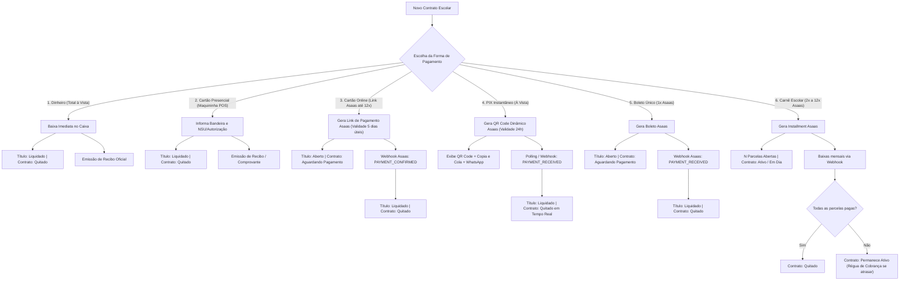

# PRD — Módulo Financeiro i-Educar: Emissão Automatizada de Contratos e Pagamentos Multimodais (Asaas & Balcão)

**Documento de Requisitos de Produto (PRD)**  
**Versão:** 3.1.0  
**Data:** 15/10/2026  
**Status:** Aprovado para Implementação (Decisões Socratic Gate Homologadas)  
**Autor:** Project Planner & Antigravity AI Engineering (Pair Programming)  

---

## 1. Visão Geral e Propósito

O fluxo de **Criação de Contratos e Matrículas Financeiras** é o ponto de contato inicial mais crítico entre a instituição de ensino, a secretaria escolar e o responsável financeiro. 

O objetivo desta evolução é transformar a emissão de contratos em um **Checkout Escolar Inteligente e Unificado**, no qual o operador escolhe a forma de pagamento no ato da criação do contrato, e o sistema orquestra instantaneamente:
1. A baixa contábil presencial imediata (**Dinheiro** ou **Cartão Presencial na Maquininha POS**);
2. A emissão de cobranças digitais seguras (**Cartão Online via Link Asaas até 12x**, **PIX Instantâneo com QR Code 24h** ou **Boleto à Vista**);
3. A geração e impressão do **Carnê Escolar Oficial em PDF do Asaas (2x a 12x)**;
4. A atualização 100% autônoma de quitação via Webhooks e Régua de Cobrança.

---

## 2. Personas e Dores Resolvidas

| Persona | Cenário / Rotina | Dor Atual | Solução Proposta |
| :--- | :--- | :--- | :--- |
| **Atendente de Secretaria (Caixa / Matrícula)** | Realiza a matrícula do aluno no balcão presencial com os pais aguardando na fila. | Precisa criar o contrato, ir para outra tela de títulos, emitir cobrança no gateway e voltar para dar baixa manual. | **Modal de Checkout Integrado no Contrato:** com 1 clique escolhe a forma de pagamento, recebe o comprovante/recibo ou dispara WhatsApp na hora. |
| **Tesoureiro / Gestor Financeiro** | Gerencia inadimplência, conciliação bancária e fluxo de caixa. | Insegurança com links de cartão que poderiam ser marcados como pagos sem liquidação real; conciliação lenta. | Separação estrita de status (`Aguardando Pagamento` vs `Ativo` vs `Quitado`), repasse automático de juros no cartão e baixa via webhook idempotente. |
| **Responsável Financeiro (Pais e Mães)** | Deseja flexibilidade: pagar à vista no dinheiro/maquininha/Pix, parcelar em até 12x no cartão com repasse de juros, ou receber o carnê impresso. | Dificuldade de acesso a boletos, juros obscuros ou demora no atendimento. | Link direto no WhatsApp, QR Code Pix na tela do balcão para pagamento imediato em 5s e carnê em PDF oficial do Asaas. |

---

## 3. Matriz Completa das 6 Modalidades de Pagamento

---

### 3.1 Detalhamento das Regras de Negócio por Modalidade

#### Modalidade 1: Dinheiro (Total à Vista)
- **Comportamento:** O pagamento é liquidado presencialmente no ato do cadastro.
- **Títulos Gerados:** 1 título único com o valor integral (com ou sem desconto à vista).
- **Status do Título:** Imediatamente `pago` (liquidado) via `BaixaTituloService`.
- **Status do Contrato:** `quitado`.
- **Ações Imediatas:** Registro na movimentação de caixa e abertura do modal de impressão do **Recibo Oficial Escolar**.

#### Modalidade 2: Cartão Presencial (Maquininha POS no Balcão)
- **Comportamento:** O pai passa o cartão físico na maquininha da escola na presença da atendente.
- **Campos Coletados:**
  - `cartao_tipo`: Crédito à Vista, Débito ou Parcelado Loja.
  - `cartao_bandeira`: Visa, Mastercard, Elo, Hipercard, Amex, etc.
  - `cartao_nsu`: Código de autorização / NSU impresso no comprovante da maquininha.
  - `cartao_parcelas`: Número de parcelas passadas na maquininha (1 a 12).
- **Status do Título:** Imediatamente `pago` (liquidado).
- **Status do Contrato:** `quitado`.
- **Ações Imediatas:** Emissão imediata de Recibo Escolar contendo a chancela de quitação via cartão POS.

#### Modalidade 3: Cartão Online (Link de Pagamento Asaas até 12x com Repasse de Juros)
- **Comportamento:** Gera um Link de Pagamento no Asaas (`POST /v3/paymentLinks`) com juros repassados ao pagador.
- **Validade do Link:** **5 dias úteis** a partir da data de emissão.
- **Status Inicial do Contrato:** `aguardando_pagamento`.
- **Status do Título:** `aberto`.
- **Ações Imediatas:** Exibe QR Code do link na tela, botão "Copiar Link" e botão com link direto para WhatsApp (`wa.me`).
- **Liquidação:** Quando o cliente passa o cartão, o Asaas dispara o webhook `PAYMENT_CONFIRMED`. O webhook dá baixa no título e atualiza o contrato para `quitado`.
- **Inadimplência:** Caso vença sem pagamento, o contrato é mantido `aguardando_pagamento` e entra na régua de cobrança automática da escola.

#### Modalidade 4: PIX Instantâneo (À Vista)
- **Comportamento:** Gera cobrança imediata via Asaas (`POST /v3/payments` com `billingType: PIX`).
- **Validade do QR Code:** **24 horas** a partir da geração.
- **Integração:** Consulta imediata de QR Code (`GET /v3/payments/{id}/pixQrCode`) trazendo `encodedImage` (base64) e `payload` (chave copia e cola).
- **Status Inicial:** Contrato em `aguardando_pagamento`, título em `aberto`.
- **Experiência em Tempo Real:** 
  - A tela exibe o QR Code e estabelece monitoramento assíncrono (Long Polling / Stream).
  - Assim que o pagamento cai (3 a 5 segundos), a tela atualiza automaticamente exibindo animação de confirmação e botão para emissão do comprovante.
  - Webhook `PAYMENT_RECEIVED` garante a baixa mesmo se o operador fechar o navegador.

#### Modalidade 5: Boleto Bancário (1x À Vista)
- **Comportamento:** Emite cobrança bancária com vencimento estipulado (ex: D+3 ou data personalizada).
- **Status Inicial:** Contrato `aguardando_pagamento`, título `aberto`.
- **Ações Imediatas:** Botão de impressão do PDF oficial do boleto Asaas (`bankSlipUrl`), código de barras e envio por WhatsApp.
- **Liquidação:** Compensação bancária automática via webhook `PAYMENT_RECEIVED`. Se vencer, a régua de cobrança notifica o responsável.

#### Modalidade 6: Carnê Escolar (2x a 12x via Asaas Installments)
- **Comportamento:** O sistema cria o parcelamento no Asaas via `POST /v3/installments`.
- **Status Inicial do Contrato:** `ativo` (aluno regularmente matriculado, com títulos a vencer).
- **Ciclo de Vida do Carnê:**
  - Cada parcela mensal paga via boleto ou Pix gera baixa automática via webhook.
  - Se houver atraso em uma parcela, o título vira `vencido` e o contrato ganha flag de `inadimplente`, sendo processado pela régua de cobrança.
  - Ao liquidar a última parcela restante (ex: 12/12), o sistema detecta saldo devedor zero e altera o status do contrato para `quitado`.
- **Ações Imediatas:** Emissão do Carnê Oficial em PDF (`GET /v3/installments/{id}/paymentBook`) pronto para impressão e entrega ao responsável.

---

## 4. Requisitos Funcionais (FR)

- **FR-01 (Checkout na Criação do Contrato):** O formulário `contratos.create` deve permitir selecionar entre as 6 formas de pagamento com botões visuais e ícones modernos.
- **FR-02 (Cartão Presencial POS):** Coleta e persistência segura de bandeira, NSU e tipo de operação da maquineta física.
- **FR-03 (Payment Links Asaas com Validade de 5 Dias Úteis):** Criação e parametrização do link de pagamento com repasse de encargos ao cliente.
- **FR-04 (PIX Instantâneo 24h com Polling):** Renderização direta do QR Code em tela e verificação periódica de status (real-time feedback).
- **FR-05 (Carnê Completo com PDF Asaas):** Criação do carnê no Asaas no fechamento do contrato, associando as cobranças aos títulos locais gerados.
- **FR-06 (Automação de Quitação via Webhook):** O `ProcessarWebhookJob` atualiza o contrato para `quitado` automaticamente quando todas as obrigações financeiras forem pagas.
- **FR-07 (Régua de Cobrança Integrada):** Contratos pendentes ou parcelas em atraso continuam sendo cobrados via WhatsApp e e-mail sem expiração destrutiva.

---

## 5. Critérios de Aceite

- [ ] Contrato criado em dinheiro gera recibo e nasce liquidado.
- [ ] Contrato criado em cartão presencial (POS) registra bandeira e NSU, gera recibo e nasce liquidado.
- [ ] Contrato criado com cartão online gera link Asaas até 12x com validade de 5 dias úteis, permanecendo aguardando pagamento até confirmação pelo webhook.
- [ ] Contrato criado com Pix exibe QR Code de 24h na tela e detecta quitação automaticamente.
- [ ] Contrato criado com boleto 1x permite impressão imediata e é compensado via webhook.
- [ ] Contrato criado com carnê gera installment no Asaas e muda para quitado apenas após a última parcela paga.
- [ ] Títulos ou contratos vencidos não são cancelados prematuramente, sendo direcionados à régua de cobrança.
