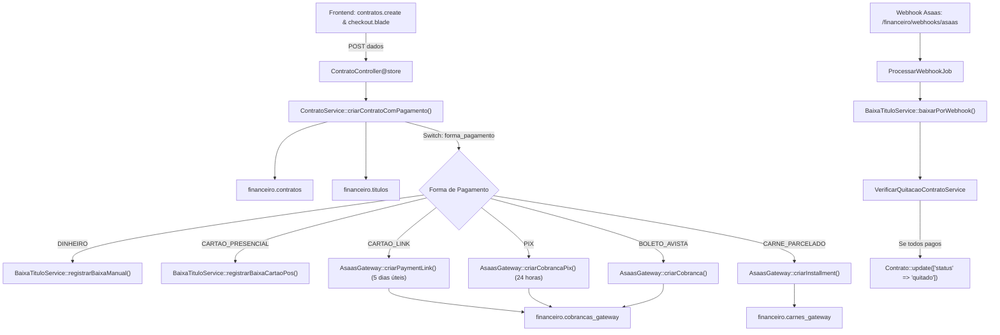

# TRD — Especificação Técnica e Arquitetura de Implementação (Pagamentos Multimodais Asaas & Balcão)

**Documento de Requisitos Técnicos (TRD)**  
**Versão:** 3.1.0  
**Data:** 15/10/2026  
**Status:** Aprovado para Implementação (Decisões Socratic Gate Homologadas)  
**Framework:** Laravel / PHP 8.3+ / PostgreSQL  
**Pacote:** `douglas14031999/i-educar-financeiro-package`  

---

## 1. Arquitetura Geral da Solução

O processo de criação de contratos evolui para uma arquitetura orientada a serviços e eventos, orquestrada pelo `ContratoService` e integrada ao gateway `AsaasGateway`.



---

## 2. Modelagem de Dados e Alterações de Schema (Migration `000024`)

### 2.1 Tabela `financeiro.contratos`
Campos adicionais para controle da modalidade e ciclo de vida:
- `forma_pagamento`: `VARCHAR(30)` (`dinheiro`, `cartao_presencial`, `cartao_credito`, `pix`, `boleto`, `carne`).
- `status`: Enum textual (`aguardando_pagamento`, `ativo`, `inadimplente`, `quitado`, `cancelado`).
- `cartao_bandeira`: `VARCHAR(50)` (para pagamentos em maquininha física).
- `cartao_nsu`: `VARCHAR(100)` (código de autorização / comprovante da maquininha).
- `cartao_tipo`: `VARCHAR(20)` (`credito_vista`, `debito`, `credito_parcelado`).
- `payment_link_url`: `TEXT` (URL do link de pagamento gerado no Asaas).
- `payment_link_id`: `VARCHAR(100)` (identificador externo no Asaas).
- `quitado_em`: `TIMESTAMP NULL` (data e hora em que o contrato atingiu saldo zero).

### 2.2 Tabela `financeiro.cobrancas_gateway`
Rastreamento unificado para links de pagamento, Pix com QR Code e carnês:
- `tipo_cobranca`: `VARCHAR(30)` (`boleto`, `pix`, `cartao_credito`, `payment_link`).
- `qr_code_base64`: `TEXT` (imagem em base64 do QR Code Pix).
- `pix_copia_cola`: `TEXT` (payload do Pix copia-e-cola).
- `link_pagamento`: `TEXT` (URL da fatura ou link de pagamento).
- `expira_em`: `TIMESTAMP NULL` (data limite de validade: 24h para Pix, 5 dias úteis para Link).

---

## 3. Especificação dos Endpoints do Asaas API v3

### 3.1 Cartão de Crédito Parcelado via Link (`POST /v3/paymentLinks`)
Permite disponibilizar pagamento em até 12x com repasse automático de juros e validade de 5 dias úteis:
```json
{
  "name": "Matrícula/Anuidade Escolar - Contrato CTR-2026-00042",
  "description": "Pagamento de anuidade escolar para o aluno João da Silva. Parcelamento em até 12x no cartão de crédito.",
  "billingType": "CREDIT_CARD",
  "chargeType": "INSTALLMENT",
  "value": 10200.00,
  "maxInstallmentCount": 12,
  "dueDateLimitDays": 7,
  "notificationEnabled": true,
  "callback": {
    "successUrl": "https://escola.ieducar.com.br/financeiro/contratos/42/sucesso",
    "autoRedirect": true
  }
}
```

### 3.2 Cobrança PIX com QR Code Dinâmico (Validade 24h)
Criação da cobrança:
```json
{
  "customer": "cus_000005829182",
  "billingType": "PIX",
  "value": 9500.00,
  "dueDate": "2026-10-16",
  "description": "Pagamento à vista da anuidade escolar via Pix (Válido por 24h)",
  "paymentExternalReference": "TIT-128"
}
```
Consulta do QR Code gerado para exibição instantânea no modal:
```http
GET /v3/payments/{id}/pixQrCode
```
Retorno mapeado:
```json
{
  "encodedImage": "iVBORw0KGgoAAAANSUhEUgAAAMgAAADICAYAAACtWK6e...",
  "payload": "00020101021226870014br.gov.bcb.pix2565...",
  "expirationDate": "2026-10-16 22:30:00"
}
```

### 3.3 Carnê de Pagamento Parcelado (`POST /v3/installments` + `GET /v3/installments/{id}/paymentBook`)
- Cria N cobranças com parcelas de mesmo valor e vencimentos sucessivos a partir da data base.
- O endpoint `/paymentBook` retorna o stream do PDF oficial contendo todas as lâminas e boletos consolidados.

---

## 4. Máquina de Estados (State Machine)

### 4.1 Ciclo de Vida do Contrato (`financeiro.contratos.status`)

| Status | Significado de Negócio | Gatilho de Entrada | Transição Seguinte |
| :--- | :--- | :--- | :--- |
| `aguardando_pagamento` | Contrato aguardando confirmação de pagamento (Pix 24h, Boleto único ou Link de Cartão 5 dias úteis). | Criação do contrato via Pix, Boleto ou Link de Cartão. | `quitado` (via webhook) ou `inadimplente` (se vencer prazo sem pagamento). |
| `ativo` | Aluno devidamente matriculado; no caso de carnê, parcelas vigentes em aberto. | Criação de contrato com Carnê ou confirmação da primeira parcela. | `inadimplente` (se parcela atrasar) ou `quitado` (todas pagas). |
| `inadimplente` | Contrato ativo que possui pelo menos uma parcela vencida e não paga, ou boleto/link vencido sem baixa. | Rotina noturna `AtualizarStatusTitulosCommand`. | `ativo` (ao pagar atrasadas) ou `quitado` (se pagar tudo). Entra na **Régua de Cobrança**. |
| `quitado` | Todas as obrigações financeiras do contrato foram 100% liquidadas (saldo = 0). | Baixa em dinheiro, baixa em cartão POS ou baixa da última parcela via Webhook. | Estado final. |
| `cancelado` | Contrato rescindido administrativamente pela secretaria. | Ação manual do operador em `contratos.cancelar`. | Estado final. |

### 4.2 Verificação Automática de Quitação do Contrato
Implementada na rotina de finalização do `BaixaTituloService`:
```php
public function verificarEAtualizarQuitacaoContrato(int $contratoId): void
{
    $contrato = Contrato::with('titulos')->find($contratoId);
    if (!$contrato || $contrato->status === 'cancelado') {
        return;
    }

    $temTitulosPendentes = $contrato->titulos()
        ->whereIn('status', ['aberto', 'parcial', 'vencido'])
        ->where('valor_saldo', '>', 0.00)
        ->exists();

    if (!$temTitulosPendentes && in_array($contrato->status, ['aguardando_pagamento', 'ativo', 'inadimplente'])) {
        $contrato->update([
            'status' => 'quitado',
            'quitado_em' => now(),
        ]);
        
        Log::info("Contrato #{$contrato->numero_contrato} foi automaticamente QUITADO.");
    }
}
```

---

## 5. Endpoints de Interface e Experiência do Usuário

1. `POST /financeiro/contratos`  
   Processa o formulário de matrícula e dispara a criação do contrato e cobrança conforme a forma selecionada.
2. `GET /financeiro/contratos/{id}/checkout`  
   Exibe a tela de confirmação e entrega dos meios de pagamento:
   - Se **Dinheiro**: Botão de impressão do Recibo Oficial.
   - Se **Cartão Presencial (POS)**: Exibe dados da autorização/bandeira e botão de Recibo.
   - Se **Pix**: QR Code grande (24h), botão "Copiar Chave Pix" e monitoramento assíncrono.
   - Se **Cartão de Crédito Online**: Botão para abrir o Checkout do Asaas e botão para envio via WhatsApp.
   - Se **Boleto**: Botão de download do PDF e linha digitável.
   - Se **Carnê**: Botão "Imprimir Carnê Oficial Asaas (PDF)".
3. `GET /financeiro/titulos/{id}/status-stream`  
   Endpoint leve para consulta de status via polling a cada 3 segundos, atualizando a tela assim que o webhook do Asaas confirmar o recebimento.

---

## 6. Segurança e Concorrência

- **Trava de Idempotência:** Uso de `lockForUpdate()` no contrato e títulos durante a baixa, impedindo conflito entre requisições de webhook e baixas de balcão simultâneas.
- **Validação de Webhooks:** Validação criptográfica do token `asaas-access-token` via `hash_equals()`.
- **Régua de Cobrança Sem Cancelamento Destrutivo:** Títulos vencidos entram no comando `financeiro:processar-regua` disparando notificações programadas sem cancelar a matrícula.
