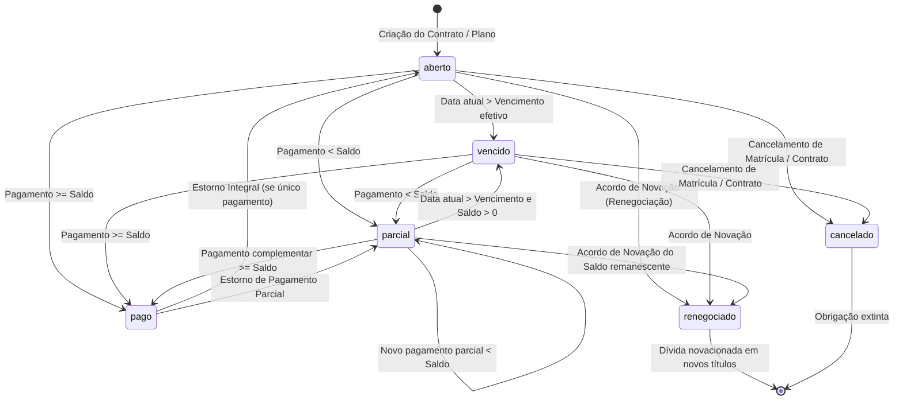

# Especificação de Regras Financeiras, Fórmulas e Invariantes

| Documento | Detalhe |
|---|---|
| **Auditoria** | Regras Contábeis, Invariantes Financeiros e Máquina de Estados |
| **Referência** | PRD de Homologação — Seções 3, 4, 9 |
| **Pacote** | `douglas14031999/i-educar-financeiro-package` |

---

## 1. Máquina de Estados do Título Financeiro

Os títulos representam obrigações financeiras (mensalidades, matrículas e renegociações). Cada título possui um ciclo de vida estrito:

### Matriz de Elegibilidade por Operação

| Status Atual | Baixa no Caixa | Emitir Boleto / Pix | Renegociar | Cancelar Contrato | Notificar Régua |
|---|---|---|---|---|---|
| **`aberto`** | ✅ Permitido | ✅ Permitido | ✅ Permitido | ✅ Permitido | ✅ Permitido |
| **`parcial`** | ✅ Permitido | ✅ Permitido (saldo) | ✅ Permitido (saldo) | ✅ Permitido (futuros) | ✅ Permitido |
| **`vencido`** | ✅ Permitido (c/ encargos) | ✅ Permitido (c/ encargos) | ✅ Permitido | ⚠️ Mantém cobrança | ✅ Permitido (inadimplente) |
| **`pago`** | ❌ Bloqueado | ❌ Bloqueado | ❌ Bloqueado | ❌ Bloqueado | ❌ Bloqueado |
| **`renegociado`** | ❌ Bloqueado | ❌ Bloqueado | ❌ Bloqueado | ❌ Bloqueado | ❌ Bloqueado |
| **`cancelado`** | ❌ Bloqueado | ❌ Bloqueado | ❌ Bloqueado | ❌ Bloqueado | ❌ Bloqueado |

---

## 2. Fórmulas e Invariantes Financeiros

### 2.1 Amortização, Saldo e Crédito Excedente
Ao receber um pagamento com valor nominal `V_pago`, encargos informados `Juros` e `Multa`, e desconto concedido `Desconto`:
1. **Amortização Bruta:**
   $$A_{bruta} = \max(0, (V_{pago} + Desconto) - (Juros + Multa))$$
2. **Amortização Efetiva Aplicada:**
   $$A_{efetiva} = \min(A_{bruta}, Saldo_{anterior})$$
3. **Crédito Excedente Gerado:**
   $$Credito = \max(0, A_{bruta} - Saldo_{anterior})$$
4. **Novo Saldo Devedor:**
   $$Saldo_{novo} = round(Saldo_{anterior} - A_{efetiva}, 2)$$
   - Se $Saldo_{novo} < 0.005$, então $Saldo_{novo} = 0.00$ e status muda para `pago`.
   - Se $Saldo_{novo} \ge 0.005$, o status é `parcial`.

### 2.2 Invariante do Estorno de Pagamento
Ao estornar uma baixa:
1. **Restauração de Saldo:**
   O saldo restaurado no título deve ser **exatamente** o valor da amortização efetiva que foi aplicada na baixa:
   $$Saldo_{restaurado} = Saldo_{atual} + A_{efetiva}$$
   - Nunca utilizar $V_{pago}$ bruto sem descontar encargos ou créditos gerados, garantindo que o saldo final nunca supere a dívida original.
2. **Tratamento de Crédito Excedente:**
   - Se o pagamento gerou crédito excedente:
     - Se o crédito **NÃO foi utilizado**: o registro em `financeiro.creditos_responsaveis` é marcado como cancelado (`cancelado = true`).
     - Se o crédito **JÁ FOI UTILIZADO**: o estorno é **bloqueado no servidor** com exceção `CreditoJaUtilizadoException`, exigindo resolução manual do saldo credor pelo operador financeiro supervisor.
3. **Concorrência e Idempotência:**
   - O registro em `financeiro.pagamentos` e o registro em `financeiro.titulos` são relidos com `SELECT ... FOR UPDATE`.
   - Se `$pagamento->estornado === true`, a operação lança `InvalidArgumentException` imediatamente sem efetuar nova mutação.

### 2.3 Cálculo de Juros e Multa de Atraso
- **Data de Vencimento Efetiva:**
  $$Vencimento_{efetivo} = \text{COALESCE}(data\_prorrogacao, data\_vencimento)$$
- **Condição de Atraso:**
  Título está vencido se $Hoje > Vencimento_{efetivo}$ e status $\in$ [`aberto`, `parcial`].
- **Multa de Atraso (Art. 52, § 1º, CDC — teto legal 2%):**
  $$Multa = round(Saldo \times 0.02, 2)$$
- **Juros de Mora Pro-Rata (Art. 406 CC — 1% a.m.):**
  $$Dias = Hoje - Vencimento_{efetivo}$$
  $$Juros = round(Saldo \times \frac{0.01}{30} \times Dias, 2)$$
- **Valor Atualizado:**
  $$Valor_{atualizado} = Saldo + Multa + Juros$$

### 2.4 Distribuição de Centavos — Algoritmo Largest Remainder
Ao parcelar um contrato de valor total $V$ em $N$ parcelas:
1. Total em centavos: $C_{total} = round(V \times 100)$
2. Base de centavos por parcela: $C_{base} = \lfloor C_{total} / N \rfloor$
3. Resíduo de centavos: $R = C_{total} - (C_{base} \times N)$
4. Cada parcela $i$ (de $1$ a $N$) recebe:
   - Se $i \le R$: Parcela recebe $(C_{base} + 1) / 100$
   - Se $i > R$: Parcela recebe $C_{base} / 100$
5. **Invariante:** $\sum_{i=1}^N ValorParcela_i \equiv V$. Fechamento contábil determinístico e exato até o último centavo.

---

## 3. Reconciliação Contábil entre Relatórios

Para evitar dupla contagem e distorções contábeis:

| Relatório | Base Contábil | Fórmula de Composição | Invariante |
|---|---|---|---|
| **Fluxo de Caixa** | **Regime de Caixa** | Entradas = $\sum valor\_pago$ de pagamentos com `estornado = false` no período | Representa estritamente o dinheiro que ingressou nas contas e no caixa físico. |
| **DRE (Resultado)** | **Regime de Competência / Arrecadação Líquida** | **Receita de Mensalidades:** $\sum (valor\_pago - juros - multa + desconto)$ **Receitas Financeiras (Acréscimos):** $\sum (juros + multa)$ **Deduções da Receita:** $\sum valor\_desconto\_concedido$ **Receita Líquida:** $(Mensalidades + Receitas\_Financeiras) - Deduções$ | Fecha rigorosamente com o montante financeiro arrecadado, sem duplicar juros e multas já embutidos no valor pago. |
